<p align="center">
  
</p>

<p align="center">
  <a href="https://github.com/Arylmera/Administratum/releases/latest"></a>
  <a href="https://github.com/Arylmera/Administratum/releases"></a>
  <a href="https://github.com/Arylmera/Administratum/actions/workflows/release.yml"></a>
  <a href="#install"></a>
  <a href="#macos-with-homebrew-recommended"></a>
  <a href="https://docs.anthropic.com/en/docs/claude-code"></a>
  <a href="LICENSE"></a>
</p>

A Windows, macOS and Linux desktop widget that shows every Claude Code session on your PC as a character in a pixel-art
office, and calls you when one of them needs an answer. Pick your world: a tech-priest scribe in a Warhammer 40k
scriptorium, a netrunner in a cyberpunk den, crew on an orbital station, an apprentice in a wizard's tower, a
dweller in a Fallout vault or a chimpanzee at a typewriter in Darwin's Victorian laboratory ([Worlds and themes](#worlds-and-themes)).

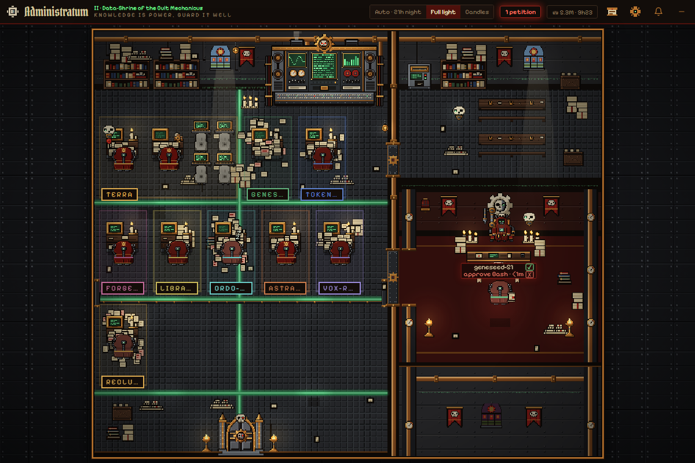

Administratum watches Claude Code's own session files and never writes to them. A session waiting on you
walks to the Sanctum and queues before the Magos. You get a desktop notification and an optional chime, and for
permission prompts in Orca terminals you can approve or deny from the widget itself.

**Contents:** [Install](#install) · [Worlds and themes](#worlds-and-themes) · [What it shows](#what-it-shows) · [Usage](#usage) ·
[Remote view](#remote-view) · [Settings](#settings) · [Privacy and safety](#privacy-and-safety) ·
[Performance](#performance) · [Troubleshooting](#troubleshooting) · [Development](#development) ·
[Licenses](#licenses)

---

## Install

| | How | Then |
|---|---|---|
| **Windows 10 / 11** | Download `Administratum_<version>_x64-setup.exe` from the [latest release](https://github.com/Arylmera/Administratum/releases/latest) and run it | [Step by step](#windows) |
| **macOS** (Apple silicon or Intel) | `brew install --cask arylmera/administratum/administratum` | [Step by step](#macos-with-homebrew-recommended), or [without Homebrew](#macos-without-homebrew) |
| **Linux** (x86_64) | Download `Administratum_<version>_amd64.AppImage` (any distribution) or the `.deb` (Debian, Ubuntu) from the [latest release](https://github.com/Arylmera/Administratum/releases/latest) | [Step by step](#linux) |

Then start a Claude Code session: its scribe walks in through the gate. To look around without any session, run
the app with `--demo`.

### Requirements

- Windows 10 or 11 (tested on Windows 11), macOS (built and run on macOS 26, Apple silicon), or Linux (built and run
  on Omarchy 4.5: Arch Linux, Hyprland, Wayland).
- Windows: Microsoft Edge WebView2 Runtime. It ships with Windows 11. On Windows 10 the installer fetches it if it is
  missing.
- [Claude Code](https://docs.anthropic.com/en/docs/claude-code) (tested with 2.1.283).
- Optional: [OpenCode](https://opencode.ai) 2.x (tested with 2.3.2). Its sessions show up beside Claude Code's, and
  their permission prompts can be answered without Orca. See [OpenCode sessions](#opencode-sessions).
- Optional: Orca (tested with 1.4.220), needed to jump to a session's terminal and to answer
  petitions from the widget. The `orca` CLI must be on `PATH`, or installed at
  `%LOCALAPPDATA%\Programs\orca\resources\bin\orca.exe` (Windows), or at
  `/Applications/Orca.app/Contents/Resources/bin/orca`, `/usr/local/bin/orca` or `/opt/homebrew/bin/orca` (macOS;
  an app started from the Dock or Finder does not see your shell's `PATH`). On Linux the CLI is `orca-ide`, on `PATH`
  or at `/opt/Orca/resources/bin/orca-ide` or `~/.local/bin/orca-ide`; `orca` there is GNOME's screen reader and is
  never run.

Each [release](https://github.com/Arylmera/Administratum/releases/latest) ships the Windows installer
`Administratum_<version>_x64-setup.exe`, two macOS disk images, `Administratum_<version>_aarch64.dmg` (Apple
silicon) and `Administratum_<version>_x64.dmg` (Intel), and for Linux an AppImage and a Debian/Ubuntu package,
`Administratum_<version>_amd64.AppImage` and `Administratum_<version>_amd64.deb`. The Windows and macOS ones are not
signed by Microsoft or Apple, so each OS warns once; the steps below get past it.

### Windows

1. Download `Administratum_<version>_x64-setup.exe` from the
   [latest release](https://github.com/Arylmera/Administratum/releases/latest).
2. Run it. If SmartScreen says "Windows protected your PC" (unknown publisher): **More info → Run anyway**.
3. The installer needs no administrator rights: it installs for your user in `%LOCALAPPDATA%\Administratum` and
   adds a Start menu entry. Its last page offers to start the widget.
4. The widget opens as a frameless, always-on-top 700 × 500 window with no taskbar button. It lives in the system
   tray (click the `^` next to the clock if it is hidden there). Its position and size are remembered between runs.
5. Optional: tray menu or Settings → **Start at login** (off by default), and Settings → System → **Add desktop
   icon**.
6. Start a Claude Code session: its scribe walks in through the gate.

**Updates:** Settings → System → Updates checks at startup and installs a new version in place (*Check now* checks
on demand). **Uninstall:** Windows Settings → Apps → Installed apps → Administratum → Uninstall; your settings and
Chronicon stay in `%APPDATA%\com.arylmera.administratum` unless you tick the uninstaller's option to delete them.

### macOS with Homebrew (recommended)

1. If you don't have [Homebrew](https://brew.sh) yet, install it (one command from its home page, in Terminal).
2. In Terminal:
   ```sh
   brew install --cask arylmera/administratum/administratum
   ```
   This picks the right build for Apple silicon or Intel, puts `Administratum.app` in Applications, and clears the
   quarantine flag, so Gatekeeper opens the app although it is not notarized.
3. Open **Administratum** from Applications or Spotlight. It has no Dock icon: it lives in the menu bar's status
   area, at the top right (the tray menu above).
4. The first notification makes macOS ask whether Administratum may send notifications: allow it.
5. Optional: tray menu or Settings → **Start at login**.
6. Start a Claude Code session: its scribe walks in through the gate.

**Updates:** the app updates itself from Settings → System → Updates, as on Windows. Because of that, a plain
`brew upgrade` skips it; `brew upgrade --cask --greedy administratum` forces Homebrew's copy up to date.
**Uninstall:** `brew uninstall --cask administratum`; add `--zap` to also delete its settings and Chronicon.

### macOS without Homebrew

1. From the [latest release](https://github.com/Arylmera/Administratum/releases/latest), download
   `Administratum_<version>_aarch64.dmg` for Apple silicon (M1 and later; Apple menu → About This Mac shows the
   chip) or `Administratum_<version>_x64.dmg` for an Intel Mac.
2. Open the `.dmg` and drag **Administratum** into **Applications**.
3. The app is not notarized, so the first launch is blocked. Either right-click it in Applications → **Open** →
   **Open**, or, if macOS says the app "is damaged", clear the quarantine flag in Terminal:
   ```sh
   xattr -dr com.apple.quarantine /Applications/Administratum.app
   ```
   Later launches open normally, and later versions install from Settings → System → Updates.
4. Continue from step 3 of the Homebrew steps above.

**Uninstall:** quit it from the tray menu, then drag `Administratum.app` to the Bin.

### Linux

1. From the [latest release](https://github.com/Arylmera/Administratum/releases/latest), download either:
   - `Administratum_<version>_amd64.AppImage`, for any distribution. It carries its own libraries and needs FUSE 2
     (`fuse2` on Arch, `libfuse2` on Ubuntu 22.04, `libfuse2t64` on 24.04). Make it executable and run it:
     ```sh
     chmod +x Administratum_*_amd64.AppImage && ./Administratum_*_amd64.AppImage
     ```
   - or `Administratum_<version>_amd64.deb`, on Debian or Ubuntu. It installs WebKitGTK and the tray library with
     it, and a launcher entry:
     ```sh
     sudo apt install ./Administratum_<version>_amd64.deb
     ```
2. Under a tiling window manager the widget first opens as a tiled window: on Hyprland, add the window rule from
   [What differs on Linux](#what-differs-on-linux) to make it a floating widget in a corner.
3. It lives in the tray, which needs a StatusNotifier tray (most bars have one; on GNOME, the AppIndicator
   extension). Petition toasts carry Approve and Deny where the notification server shows actions.
4. Optional: tray menu or Settings → **Start at login** writes `~/.config/autostart/Administratum.desktop` (for the
   AppImage, pointing at the `.AppImage` file), which XDG desktops and systemd-based sessions such as Omarchy's
   start at login.
5. Start a Claude Code session: its scribe walks in through the gate.

**Updates:** Settings → System → Updates replaces the AppImage in place; the `.deb` installs through a password
prompt (`pkexec`). **Uninstall:** delete the AppImage, or `sudo apt remove administratum`; settings stay in
`~/.config/com.arylmera.administratum` and the Chronicon in `~/.local/share/com.arylmera.administratum`.

### What differs on macOS

The widget has no Dock icon and no menu bar menu of its own: it lives in the menu bar's status area (the tray menu
above). Its settings and Chronicon are in `~/Library/Application Support/com.arylmera.administratum`. Differences
from Windows:

- **Open departments with**: *Finder* or VS Code (through `open -a "Visual Studio Code"`), or a custom command.
- **Remote view**: there is no firewall rule to add. If the macOS firewall is on, macOS asks once whether
  Administratum may accept incoming connections: allow it. The *Add desktop icon* button is Windows-only too.
- **Petition toasts**: Approve and Deny sit in the notification's *Options* menu, Deny first, so a click on the
  *Options* button itself denies, never approves. A click runs the same checks as on Windows.
- **Night Vigil** shuts down through System Events. The first vigil that reaches zero makes macOS ask whether
  Administratum may control System Events (Automation); unanswered, the Mac stays on. Let one vigil run out while
  you are there and allow it (it then shows in *System Settings → Privacy & Security → Automation*). An app with
  unsaved work can still refuse the shutdown.

### What differs on Linux

Built and run on Omarchy 4.5 (Arch Linux, Hyprland 0.56, Wayland, WebKitGTK 2.54). Settings are in
`~/.config/com.arylmera.administratum`, the Chronicon in `~/.local/share/com.arylmera.administratum`. Differences
from Windows:

- **The window under Wayland**: a Wayland window can neither place itself nor stay above the others; the compositor
  does both. On Hyprland a window rule makes the hall a small floating widget in a corner, above tiled windows and
  on every workspace (`pin`). In Hyprland's Lua config (0.55 and later; on Omarchy 4.5,
  `~/.config/hypr/hyprland.lua`):

  ```lua
  hl.window_rule({
    match = { class = "^administratum$" },
    float = true,
    pin = true,
    size = { 700, 500 },
    move = { "(monitor_w-window_w-40)", "(monitor_h-window_h-40)" },
  })
  ```

  An older Hyprland takes the same rules (float, pin, size, move) in its `hyprland.conf` syntax, see Hyprland's
  [window rules](https://wiki.hypr.land/configuring/core/rules/window-rules/). The header still drags the window and
  its edges resize it. *Always on top* is not offered under Wayland; in an X11 session it is, as on Windows.
- **Desktop strip and column**: on compositors with layer-shell (Hyprland, Sway, KDE Plasma; built and run on
  Hyprland). Wayland lets no window place itself on a screen edge, so the strip is a layer surface, as bars and
  docks are: it lies over the bottom of the screen (the column over a side), above the windows, on the monitor the
  hall was on, and clicks between the characters go to the window under it. Settings → **Keep windows off the
  strip** makes the compositor keep that edge free instead. Switching between the hall and the
  strip opens one window and closes the other, so the cast walks in again. On GNOME and in an X11 session there is
  no layer-shell: Settings offers neither and the tray item stays greyed.
- **Tray**: on Omarchy the icon sits in the bar's tray drawer, behind the `<`; pin it there to keep it in view.
  Launching Administratum again also brings a hidden window back.

---

## Worlds and themes

Settings → Hall → **World** picks the world, **Look** a variant within it. Each world outside Warhammer has its own
art for every character and object, both views (Flat and 2.5D), the desktop strip and its own wording: the
sessions, the boss who receives petitions, the subagents and the notifications all change name.

<table>
<tr>
<td width="50%">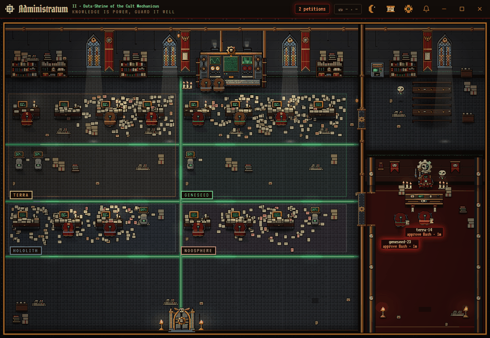<br>
<b>Warhammer 40k</b>: tech-priest scribes at their lecterns, bone-robed adepts, the Magos on his throne, servo-skulls,
gothic windows and banners. Styles: <i>Ordo Administratum</i>, <i>Machinum</i>, <i>Xenos</i>, <i>Malleus</i>,
<i>Hereticus</i> (high contrast).</td>
<td width="50%">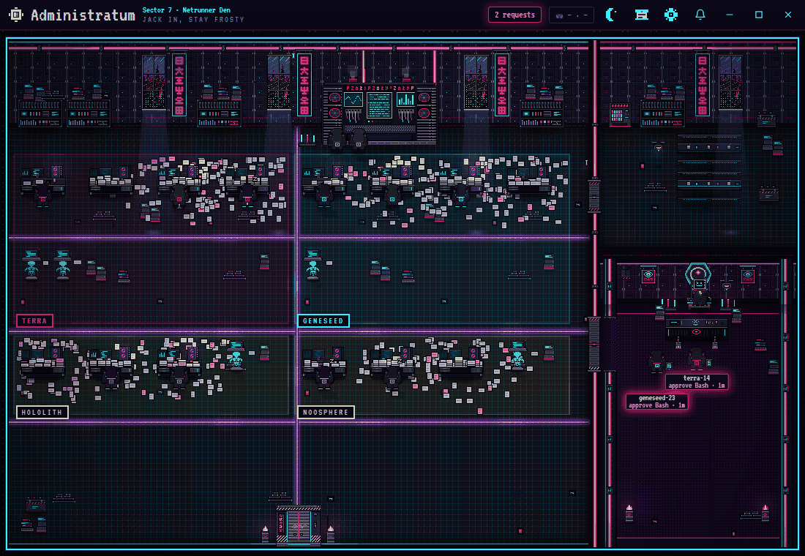<br>
<b>Cyberpunk</b>: netrunners jacked in at their rigs, daemon subagents, the fixer, neon kanji signs and a city window.
Styles: <i>Neon Grid</i>, <i>Corpo Tower</i>, <i>Rain City</i>, <i>Green Code</i>, <i>Sunset Drive</i>.</td>
</tr>
<tr>
<td>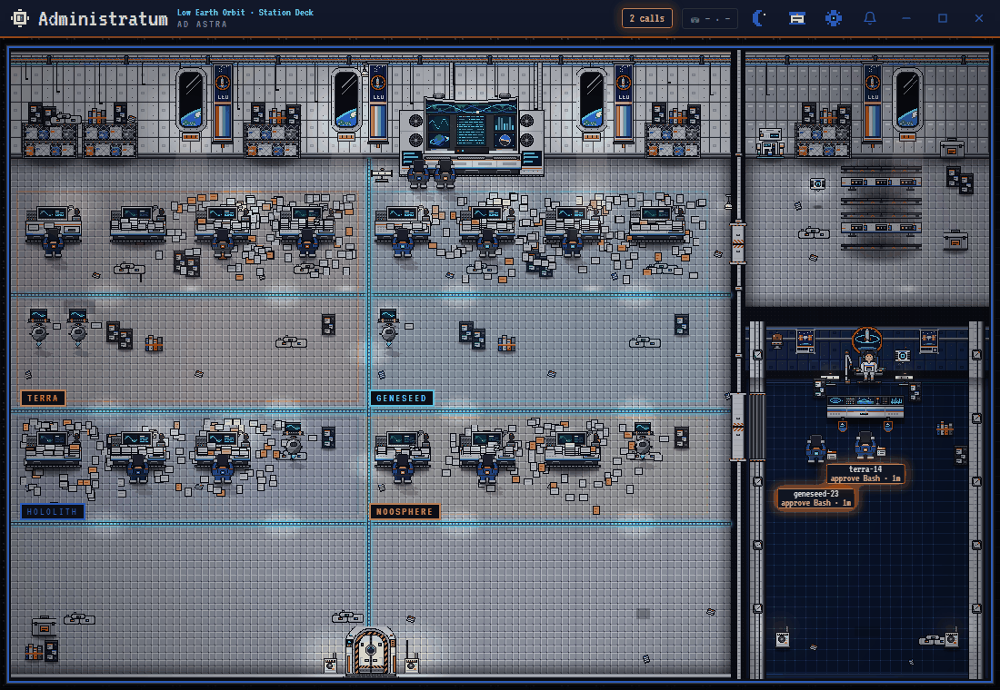<br>
<b>Space</b>: crew at the station desks, bot subagents, the Commander, portholes and white hull panels.
Style: <i>Orbital Station</i>.</td>
<td>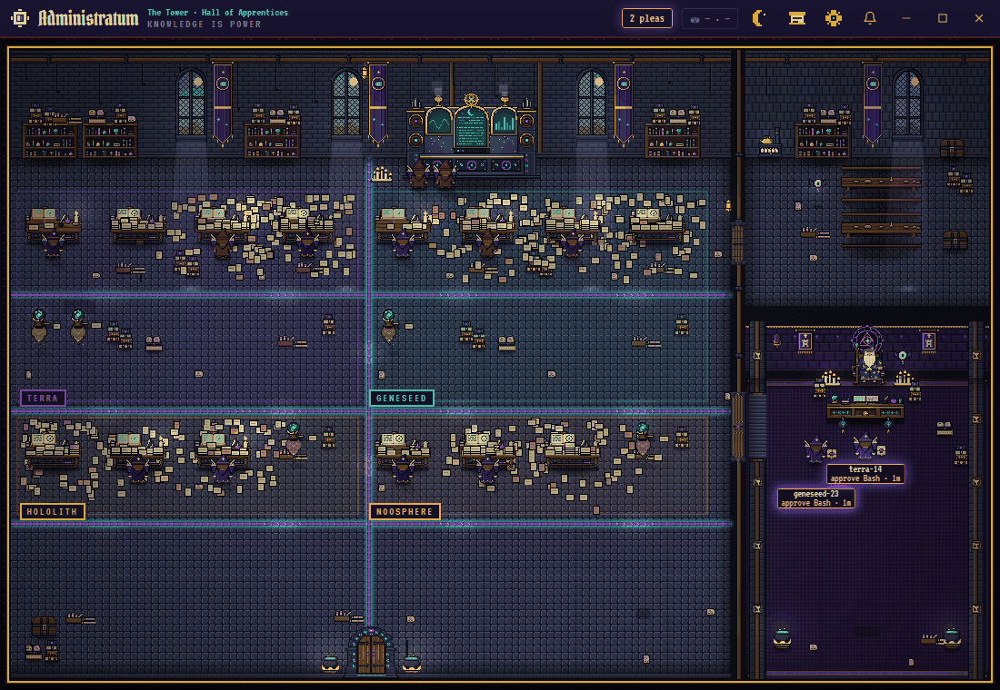<br>
<b>Fantasy</b>: apprentices at their reading desks, familiars, the Archmage, arched windows and violet hangings.
Style: <i>Arcane Tower</i>.</td>
</tr>
<tr>
<td>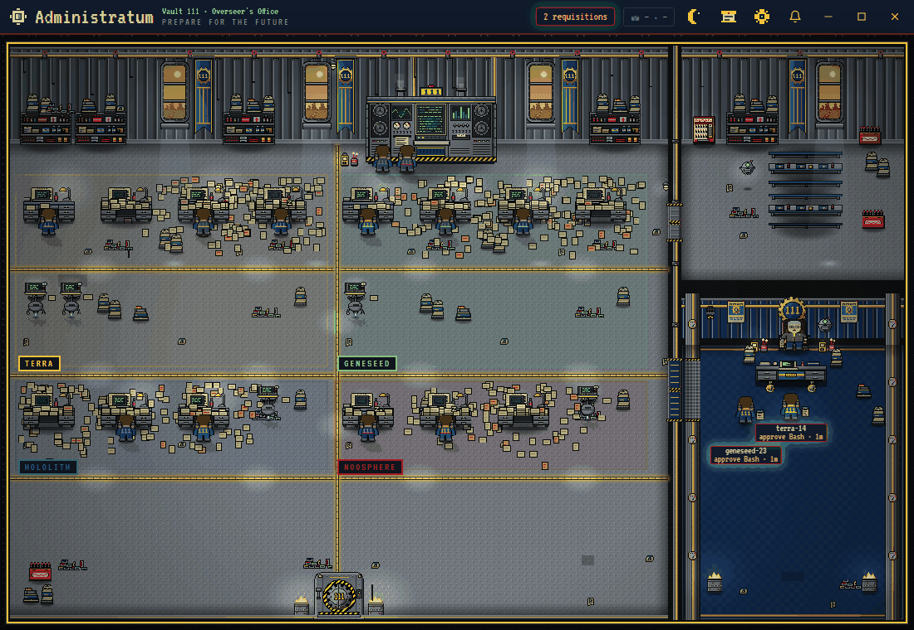<br>
<b>Fallout</b>: vault dwellers at RobCo terminals, Mr. Handy robots, the Overseer with his clipboard, the cog vault
door and a Nuka-Cola machine. Style: <i>Vault 111</i>.</td>
<td>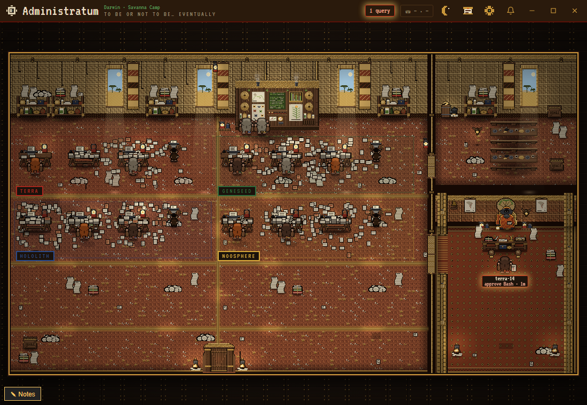<br>
<b>Darwin</b>: chimpanzees at their typewriters (the infinite monkey theorem) on oak lab benches, capuchin lab assistants
for subagents, Charles Darwin himself checking the work with his magnifying glass, specimen jars, brass microscopes and
gaslight, and a Galapagos finch. Style: <i>Darwin</i>.</td>
</tr>
<tr>
<td colspan="2">Every sprite of every world, side by side: the <a href="docs/sprites/README.md">sprite gallery</a>, or
<code>tools/sprites.html</code> in a local checkout (one column per style). The remote view keeps its own theme, so
a phone can show a different world than the PC.</td>
</tr>
</table>

**Themes from others.** A theme pack is a GitHub repository holding one or more themes made by someone else: a new
world, or a new style for a world the app ships. To add one, type its `owner/repo` (or paste its GitHub address) in
Settings → Hall → **Added themes** → *Add from GitHub*, then *Install*. Its themes appear in the World and Look lists
after *Restart to apply*. The same list updates or removes a pack; *Update all* updates every pack from GitHub at
once. At start, the app checks the added packs for changes (*Check added themes for updates at startup*, on by
default): if one changed, a toast offers *Update*, which updates them and restarts, or *Later*. A pack is data only: colours, wording and pixel
art, checked when it loads; it cannot run code, and a theme that does not load is left out with the reason on its
pack's line. A folder of themes dropped by hand into the `themes` folder beside the app's Chronicon shows there
too, as a local folder. The Breaking Bad world, once shipped with the app, is such a pack now:
`ChristianLemer/adm-themes`. To make your own: [Making a theme pack](docs/theme-packs.md).

---

## What it shows

Each running Claude Code session is a **scribe**. Each project (the last segment of the session's working
directory) is a **department**, a coloured rug with its name on a plaque. A session's active subagents are its
**adepts**.

| You see | It means |
|---|---|
| Scribe at its desk, screen and candle lit; its screen runs (where the world's desk has one): a line typed for an edit, a page scrolling for a read, a bar sweeping for a search, rings for the web and its arms type (the Imperium's robe) | Session is working (`busy`) |
| Scribe at the cogitator bank (back wall) | Session is running a shell command. It stays there 10 s after the last one so quick Bash calls don't send it back and forth |
| Scribe dozing at the desk (`z z`), candle out | Turn done, waiting for your next prompt (`idle`) |
| Scribe at its desk thinking now and then, stretching as it dozes off, puzzled for a moment | Gestures, in a world that draws them (the Imperium's do, a theme pack can: [docs/theme-packs.md](docs/theme-packs.md#gestures)). Think: working. Stretch: the turn just ended. Puzzled (wonder): a tool error, or a question waiting at the desk (questions turned off in Settings > Alerts) |
| Small brass cog turning on the desk corner | Idle, but a background shell it started is still running. The scribe stays at its desk |
| Scribe at the recaff dispenser, then asleep on a Refectorium bench | Idle for more than 2 min with no background shell. If every bench is taken, it dozes at its desk |
| Scribe queued in the Sanctum holding a sealed scroll, red label above it | **Petition**: the session is waiting on you. The label says what it wants (`approve Bash`, `input needed`...) and for how long |
| Scribe queued behind the petitioners with a question scroll, parchment label `question` | **Question**: the turn ended on a question to you. It queues like a petition, behind the real ones, with a toast and a softer chime; the header counter turns parchment-coloured when only questions wait. Both can be turned off in Settings > Alerts |
| Beacon on the Sanctum wall sweeping red, servo-skull hovering by the petitioner, header counter flashing | The petition has waited past the stale mark (5 min). You get a second toast and a different chime |
| Small grey figures at consoles in the department | **Adepts**: the session's active subagents, four consoles per desk slot. One leaves when the parent transcript reports it completed, or when its own transcript has been quiet for 10 min |
| Desk on a dais, a cable on the floor from it to other scribes' feet | **Suzerain**: a session that forked real child sessions (Claude Code desktop's `start_session`). Its children sit in its department, wherever their own folder is, and the cable runs to each; a pulse runs down it while the Suzerain works. Each world draws its own: a Mechanicus plinth and data cable, a neon plate and optic fibre, a command deck and umbilical, a rune circle and arcane thread, the Overseer's platform and a Vault-Tec pipe, a Persian rug and a hemp rope. Plain subagents stay adepts |
| Paper piled on the desk | The session's context. The desk is full at 50 % of the model's window. Past that, sheets fall around the desk and spread over the department floor. Red sheets from 90 % |
| Scribe carrying its pile to a brazier at the gate and burning it | **Compaction**: the session's context was compacted. If the scribe is away from its desk, the pile goes up in a puff instead |
| Gilded robe / plain red robe / faded robe | **Model rank**: Opus or Fable = *Magos*, Sonnet and others = *Tech-priest*, Haiku = *Novice*. Adepts carry the same marks |
| Wizard smoking a long churchwarden pipe, its ember glowing and pale smoke rising, now and then a ring (Arcane Tower only) | A Wizard or the Archmage (not an Apprentice) that is not working: `idle` or a petition waiting. Seen from behind, the pipe pokes out left of the head |
| Scribe walking in through the grand gate / gathering papers and walking out | Session started / session ended |
| Purity seal stamped on a parchment on the desk (up to 3 stay) | A `git commit` succeeded |
| Servo-skull picks up a seal and flies out of the gate | A `git push` |
| A small lamp beside each scribe's desk (in each theme's own art), unlit / amber / green / red (also told apart without colour: green a lens with a bright check, red a dark X, unlit flat dark glass, amber the round blinking lens) | **CI** after a push, opt-in (*Show the CI result after a push*, off by default). The scribe's own lamp: amber while the CI of its last push runs, green when every check passed, red as soon as one failed; it stays until that scribe's next push or its end, and is absent when it has nothing to show or when the push went to the department's default branch (the beacon shows that one), so a lamp marks a scribe working on another branch, a worktree's. No scribe lamp in the desktop strip and column (the card line carries it there). Hover or click it for `<branch> · <sha7> · <state>`; a click opens the commit's checks page on GitHub. A push that printed no ref line (an up-to-date or `-q` push) gets no verdict |
| A larger beacon at the east end of each department's block (in the rooms plan: in a column beside the room's computer, one per folder of the room; the plaque cell in the desktop strip and column), unlit / amber / green / red | **CI of the main branch** (the GitHub default branch of the folder's repository), same opt-in. Checked every 5 min, and at once (and again 2 min later) when a scribe of the department ends its turn or leaves, so a merge shows quickly; a new head is followed every 30 s until its verdict. Unlit: during a rate-limit pause, after 3 failed calls, or on a `gh` access error. No beacon when the folder is not a GitHub repository or its repository has no default branch. Hover or click it for `main · <sha7> · <state>` (the branch's real name); a click opens that commit's checks page. A verdict on a new head is a `ci-pass` / `ci-fail` event in the Chronicon, once per commit |
| A line `CI · main · 5d6e7f8 · running 3/5` (or `passed`, `failed: <check>`, `no verdict after 30 min`) on a session's card | The same CI result for the commit that session pushed; it stays until that session's next push or its end. Clicking it opens the checks page. A pass or a fail is also a `ci-pass` / `ci-fail` event in the Chronicon. No toast |
| Green lamp on the desk (20 s) / blinking red lamp | Test run passed / failed (`cargo test`, `npm test`, `npm run test`, `pnpm test`, `yarn test`, `pytest`, `vitest`, `jest`, `go test`) |
| Spark and smoke puff on the desk | A tool call returned an error |
| Scribe raises its scroll, gold glint, soft chime | A turn that took 5 min or more finished |
| Scribe stays at its desk under a `sealed · resets 14:00` tag | The session hit a subscription usage limit. One toast per wave: sessions sealed until the same hour share it. The tag goes at the reset hour or at the next prompt. The wording follows the theme (*throttled* in the cyberpunk den, *grounded* on the orbital station) |
| `✎5` by a working scribe's desk | Files the current turn has changed (Edit, Write, MultiEdit, NotebookEdit). The card lists them |
| Plaque in the first back-wall alcove, four names on it | **Hall of Honours**: the past 7 days' marks, each held by a department: most commits, the longest single task, most petitions answered within a minute, and the busiest day by working time (with its date). An empty mark shows `—`; a tie goes to the latest. Each world draws its own plaque and names it (*Honours of the Week*, *Leaderboard*, *Crew Honours*, *Roll of Laurels*, *Employee of the Week*, *Fellows of the Week*). Click it to open the Chronicon on its Week tab. Alcoves exist only in a wide hall, so a narrow window shows no plaque; the strip never does |

Adepts play a smaller version of these reactions at their console.

**Space.** A scribe keeps its desk. An empty desk is held 3 min for a newcomer from the same department, and
an empty department block stays 5 min, so a short restart doesn't reshuffle the hall. When the hall is full, desks
turn into compact lecterns (6 per row instead of 4). If that is still not enough, the hall grows downward by up to
6 bays. Only past that point does a `+N in the stacks` plaque appear. Their petitions still toast and count in the
header. The hall shrinks back once it has had room to spare for a minute.

**Lighting.** *Auto* follows the clock: day 08–18 h, dusk 06–08 h and 18–21 h, night otherwise. If you set a
latitude and longitude in Settings, *Auto* follows the real sun instead: civil dawn and dusk plus the half hour of
low sun count as dusk. The lighting choice lives in Settings > Appearance: its *Auto* entry shows the hour and the phase
(`Auto · 22h night`), and its tooltip today's sunrise and sunset. *Full light* and *Candles* pin the day or night
look; the tray's *Cycle lighting* steps through the three. At night the hall is dark, apart from pools of light around the candles,
braziers, screens and coolant channels.

**Depth.** The hall is flat pixel art drawn to read as a volume: a soft shadow under everything that stands on the
floor, the floor darkened along the wall feet, shadows cast by the nearest lamp at night (by the window light by day),
light pools lying flat on the floor, a bright patch where each window beam meets the floor, walkers that bob,
servo-skulls with a shadow below them, a back wall that trails a little behind a pan, and the far end of the hall
slightly darker and greyer. No art changes: every effect is computed from the existing sprites.

**Liveliness.** Settings > Appearance > Liveliness: *Off* (the hall as it was: no typing arms, running screens or
gestures, nothing below), *Subtle* (less of it) or *Full* (the default). Pulses of light run along the floor channels
(open space plan), the window beams breathe and drift by day, sparks rise over the braziers. A cloud's light drifts over
the window glass (not in orbit or the vault). The hall follows the load: the more sessions work (four is full), the faster the pulses and the Magos and the brighter the room;
a stale petition dims it a little. A finished adept reports
at its owner's desk before it leaves; a newly forked session gets its order by servo-skull from its Suzerain; the Magos
leans toward a new petitioner. The ambient motion never raises the frame rate at rest.

**Views.** Settings > Appearance > View switches the hall between three views, live:

- **Flat** (the default): the 3/4 pixel-art hall described above.
- **39°**: the same hall turned 39° and seen from above, the back wall receding 3:1 and the west wall 2:1. Walls,
  floors and props are real volumes: desks, shelves, crates and the cogitator are boxes, candles, drums and censers
  are cylinders, gauges and cog wheels are discs standing proud of their surface, screens sit recessed in a bezel.
  The inner walls are cut away to a low height so every room stays in view; the doorways keep their posts and lintel.
  Scribes and adepts walk in four diagonal facings and sit at their desks; everything is
  depth sorted by its floor footprint, with contact shadows, cast shadows at night and lights lifted off the floor
  (each desk-level glow at its own source's height: candle flame, slate, console screen, flying skull; its pool on the
  floor under it). At Auto scale the turned hall shrinks to fit the window, but never below the flat view's Auto pixel
  size: a bigger hall keeps those pixels and pans (drag, arrow keys, edge arrows); an explicit Scale pans, as in the flat view.

  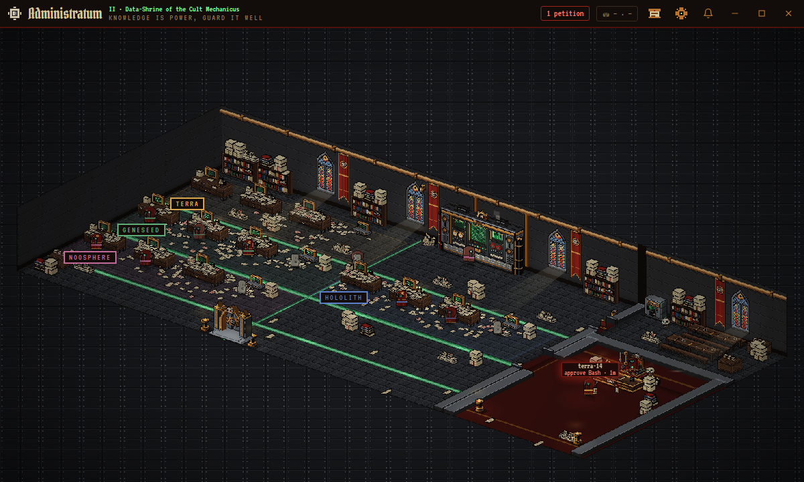

- **Desktop strip**: a thin, transparent, click-through bar pinned to the Windows taskbar (on macOS, above the
  Dock, on every Space), outlined pixel art
  over whatever is behind it. Left to right: a handle with its own small menu (Hall view, Settings, Chronicon,
  Hide), each department's lecterns and its adepts' consoles on a coloured mat with a name plaque, the cogitator,
  the recaff and bench where idle scribes nap, the petition line and the Magos at the right end. It is click-through
  everywhere except over a character, a label, a plaque, the handle and its open menu, or another open panel; a
  panel (card, Settings, Chronicon) opens by growing the window upward, above the strip. On Windows a click lands at
  once (a mouse hook decides click-through on each mouse event); on macOS the cursor must rest about 50 ms first. The strip re-places itself when the taskbar, its monitor or its DPI changes. Strip
  size (S/M/L) and an optional backdrop are in Settings. It sits best with a taskbar or Dock at the bottom of the
  screen; with one on a side it stands on the bottom of the screen. On macOS it does not show over full-screen apps.

- **Desktop column**: the strip stood on end, a narrow transparent click-through column the full height of the work
  area on the left or right screen edge (Settings, *Column side*; right by default, desktop icons sit on the left).
  Floors top to bottom: the Sanctum (the Magos and the petition line), one floor per department (its lecterns, its
  adepts' consoles behind them, its plaque on the floor slab), the cogitator, and the refectory at the bottom, where
  scribes come in from the screen edge. One lift on the inner side carries the scribes between floors: they queue at
  its landing (a lamp lights while someone waits), it takes up to three at once and stops on its way for anyone going
  the same way. Adepts never ride; they appear at their console's floor. A short screen drops the size L -> M -> S until
  four department floors fit; departments past the last floor (and scribes past six lecterns on one) are hidden and
  counted on the cogitator's floor. Panels open beside the column. Each world draws its own shaft, car and floor slab.

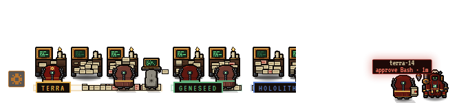

Both views draw from one art source, and every world (Warhammer, Neon Grid, Orbital Station, Arcane Tower, Vault 111, Darwin)
has its own 39° art. Every world also has a tall window on the back wall and full-height hangings (gothic window and
banners in the Warhammer themes, each other world its own design), in both views. The remote view keeps its own View.

**Header.** From left to right: petition counter, Tithe plaque (`⛁ tokens · working time` today, with the
usage-window bar under it, see [Chronicon and Tithe](#chronicon-and-tithe)), Chronicon,
Settings, a moon while quiet hours are on, mute chime, then the window buttons: **–** hides to the tray (the window
has no taskbar button), **□** maximizes and restores, **✕** quits. To move the window,
drag the header.

---

## Usage

### Characters and the card

- **Hover** a character to see its name.
- **Click** a scribe or adept to open its card, a small parchment at the bottom of the hall (above the desktop strip,
  beside the desktop column). If the session runs in an Orca terminal, that terminal is also brought to the front. Click again, press **Escape**, or click elsewhere to close the card. With *Show the card when
  I click a character* off (Settings > Hall), a click only brings the terminal to the front; the card still opens for
  a petition it can answer, for a session outside Orca, and always in the remote view.
- The card shows the scribe's name and department, state and time in state, context (`184k / 200k (92%)`),
  model and rank, the last task line, the turn (`Turn · 4 min · 23 tools · 5 files`, then the files it changed),
  and the project path. An adept's card shows its subagent type, its owner,
  model, context and task. A Suzerain's card lists its forked children (`Suzerain of: …`), each with its state
  and the tokens it spent today, a child's names its parent (`Summoned by …`); both end with the lineage's total
  (`Lineage today: 6.1M tokens`, the parent and its live children). Click a name to open that session's card.
- **Open in Orca** switches Orca to the session's terminal. It is shown only for sessions started inside Orca,
  which Administratum detects from the `ORCA_TERMINAL_HANDLE` variable of the `claude.exe` process, and not on a card
  whose click already did it (it comes back when an answer fails, or when the terminal could not be opened). A card reached another way,
  such as a name in a Suzerain's lineage, keeps it.
- **Open on claude.ai** opens the session's `https://claude.ai/code/...` page in your default browser. It is shown
  only when the session record carries a claude.ai session id (Remote Control on). While the Claude desktop app runs
  on this PC, the button reads **Open in Claude** and opens the session in the app instead (`claude://code/<id>`).
  The remote view always opens the web page, on its own device.
- Clicking a petitioner also copies `name path` to the clipboard, so you can find the pane yourself.
- **Click a department's plaque** to open its folder (the most recently active session's working directory) in
  Explorer (Finder on macOS), VS Code or a command of your own (Settings > Work). A branch other than `main` / `master` shows under
  the department's name, read from `.git/HEAD` (worktrees included).

### Answering petitions

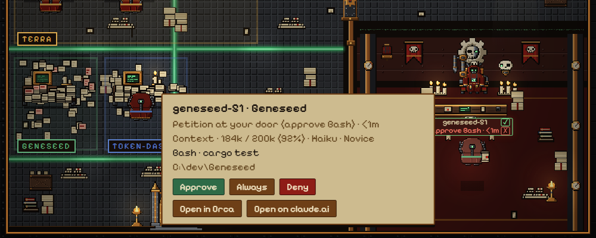

When a petition is a **permission prompt** (`approve ...`) in an **Orca** terminal, the widget can answer it.
Use **✓ / ✗** on the queue label, or **Approve / Always / Deny** on the card. *Always* picks the prompt's first
"Yes, ..." option (don't ask again / allow all edits). If the prompt has no such option, it returns an error.

The petition toast itself carries **Approve** and **Deny** for the same prompts (permission, in Orca). A click runs
the same check below. If the petition was already answered in the terminal, nothing is typed. *Always* stays on the
card: on a toast it could be clicked without reading the prompt. On Linux the buttons are the notification's actions:
GNOME Shell, KDE Plasma, Omarchy (4.5 and later), dunst, mako (`makoctl menu`) and swaync show them; a notification
server that does not shows the toast without them, and the card still answers.

What happens when you click:

1. The backend runs `orca terminal read --terminal <handle> --screen --json` to read the terminal as currently
   rendered.
2. It checks that the screen really ends with a Claude Code permission dialog. That means the last
   `Do you want ...` line, followed by options numbered from 1, starting with a plain `Yes` and including a
   `No`, with nothing under them but a short footer. A dialog that has scrolled up under later output, or an
   input box below the options, does not count.
3. Only then does it run `orca terminal send --terminal <handle> --text <digit>`, typing the **single option
   digit** for your choice.

Nothing read from the screen is sent anywhere or shown back. Only that one digit is typed. If the check fails,
nothing is typed and the card says *No permission prompt visible — open the terminal*. Free-text petitions
(`input needed`, open dialogs) can't be answered from the widget. Use **Open in Orca** for those.

### OpenCode sessions

Sessions of OpenCode 2.x (the `opencode` TUI) are scribes too, read from OpenCode's own database
(`~/.local/share/opencode/opencode.db`) and its local service. Nothing to configure.

- A session is shown while it runs or waits on a permission. Once idle it stays while an `opencode` TUI runs in its
  folder, for at most 15 minutes: quit the TUI and the scribe leaves within a few seconds. OpenCode records nothing
  that says which session a TUI has open, so two TUIs in one folder keep its idle sessions until both are closed.
  Its subagents are its adepts; a subagent's permission prompt shows on its parent.
- Its permission prompts are answered with **✓ / ✗**, the card or the toast, through OpenCode's service, Orca or not.
  **Deny also refuses the session's other pending requests**, and *Always* approves the matching ones (OpenCode's
  rule). An answer is sent only while that request is still shown.
- Chronicon events (tests, commits, pushes, edited files) and Tithe tokens are counted as for Claude Code.
- Not seen: OpenCode before 2.0, TUIs started with `--standalone` (they register no service), and OpenCode's
  sessions while OpenCode is closed. There is no **Open in Orca** link for an OpenCode session.

### Remote view

Watch the hall from a tablet or phone on the same network, in its browser:

1. Settings > Remote view > **Serve on the local network** (off by default; port 7770). Off, the app still listens on
   `127.0.0.1` only (this PC), with the same pairing token, for `tools/adm.mjs`.
2. Windows: **Allow this port** adds the Windows Firewall rule (Windows asks for administrator permission). macOS:
   see [macOS](#what-differs-on-macos).
3. Scan the QR code with the device's camera. It opens `http://<this PC>:7770/?t=<token>` and pairs the device;
   the link is then remembered in a cookie.

On a phone (a screen 640 px wide or less) the link opens a light page instead: the petitions waiting, the Night
Vigil, every session with its state and tokens today (forked children under their Suzerain), and today's Chronicon
totals, in the theme's colours. When remote actions are allowed, the Night Vigil has Arm / Cancel, and a tap on a
permission petition shows its prompt, then **Approve** / **Deny** (the same checks as on the PC). *Always* stays on
the PC, and questions and other petitions are shown only. Its **Full hall** link opens the hall.

The remote page shows the same hall, cards and Chronicon, live. It keeps its own lighting, scale, theme, view and
chime; the PC's settings are shown read only. **Allow remote actions** (off by default) lets a paired device approve
or deny permission prompts, with the same on-screen check as on the PC; anyone with the link on your network can
then do it; the prompt a card shows (`peek_petition`, the question and its options) is read only when this is on.
*Open in Orca* and opening folders never run from a remote device. **Regenerate token** unpairs every
device. Only private and local network addresses are answered. The HTTP API is documented in
[docs/remote-api.md](docs/remote-api.md).

### Chronicon and Tithe

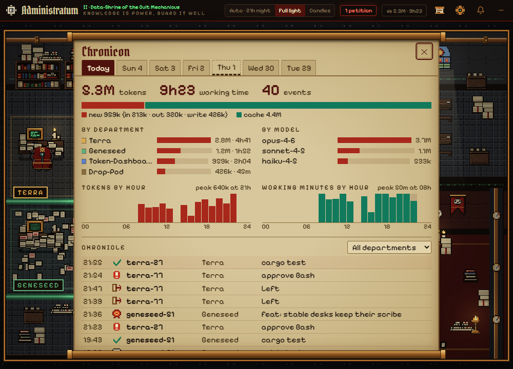

To unroll the Chronicon, click the scroll icon or the Tithe plaque in the header. It has one tab per day (today
and the 6 previous days) and a **Week** tab that adds those 7 days up (with a tokens-by-day chart instead of the
hourly ones). Each day shows:

- **Tithe**: tokens (new input/output vs. cache), working time (time sessions spent busy or in a shell),
  event count, tokens and time per department and per model, the top 10 sessions by new tokens, and 24-hour charts
  of tokens and working minutes. Today's tab also has the usage-window line, for example
  `Window: 2.1M since 13:40 · ceilings 3.4M, 4M`.
- **Day report** (folded): sessions seen and finished, turns, working time, tokens, and per department its turns,
  tokens and the files edited, plus counts of commits, pushes, failed tests, usage limits, stuck sessions and token
  alerts. *Copy as markdown* puts it on the clipboard. It can also be written to a folder each night (Settings >
  Work > Night Vigil).
- **Chronicle**: the event log, newest first. It covers commits, pushes, test passes and failures, tool errors,
  long tasks finished, arrivals, departures, petitions opened and answered, compactions and usage limits. You can filter it
  by department. While the Chronicon is open, new events appear at the top.

Tokens are counted once per assistant message. Subagent tokens count toward the parent's project. A forked session
(Claude Code desktop's child sessions) opens with a copy of its parent's history; that copy is skipped, the parent
already counted it. On first sight
of a transcript, only today's entries are read. Earlier days are not reconstructed.

**Usage window (an estimate, this PC only).** The thin bar under the Tithe plaque shows the new tokens (input,
output and cache writes; cache reads are not counted) spent on this PC in the current 5-hour usage window. A window
opens at the hour of the first token after the previous one closed (a token at 10:20 opens the 10:00 window, as
Claude's "resets 2pm" suggests) and lasts 5 hours. A usage limit that names its reset hour
fixes the window to the 5 hours before that reset. Each tick on the bar is a ceiling: this PC's share of the window
at a past limit hit (limits recorded in the last 7 days), and the lowest tick is marked. Until a limit is recorded,
the bar is an empty frame. The app cannot see your real quota: use on claude.ai or on another machine spends the
same quota and does not show here. OpenCode tokens count only from Anthropic models. Days recorded by 0.6.8 or older
give no share and no ceiling; on the day you update, the count is complete only from the first token after the
update, so a ceiling (or the window's start time) that reaches before it is not shown.

To close the Chronicon, click ✕, press **Escape**, or click outside it.

### Settings

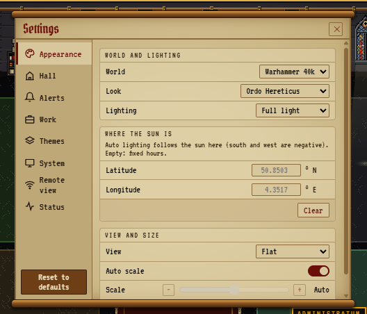

Open Settings with the gear in the header. Changes apply immediately. The panel has eight tabs: Appearance, Hall, Alerts, Work, and on the PC Themes, then System, and on the PC Remote view and Status. Each tab is a stack of cards, one card per subject, one row per setting (its label left, its control right), the hint under the row it explains and the card's buttons in its foot. Tab and Shift+Tab stay inside the open panel, the arrow keys move between the tabs, and Esc closes it and returns to the gear.

**Appearance**

| Setting | Default | Effect |
|---|---|---|
| World | Warhammer 40k | The world: Warhammer 40k, Cyberpunk, Space, Fantasy, Fallout, Darwin. Each world outside 40k has its own art |
| Look | Ordo Administratum | A theme within the world: colours of the hall and the window, and the wording. Warhammer 40k: Ordo Administratum, Machinum, Xenos, Malleus, Hereticus. Cyberpunk: Neon Grid, Corpo Tower, Rain City, Green Code, Sunset Drive. Space: Orbital Station. Fantasy: Arcane Tower. Fallout: Vault 111. Darwin: Darwin |
| Lighting | Auto | Auto / Full light / Candles (see *Lighting* above) |
| Latitude / Longitude | empty | Where *Auto* lighting takes its sun (south and west are negative). Empty = fixed hours |
| View | Flat | Flat / 2.5D (the 39° view) / Desktop strip / Desktop column (Windows and macOS; see *Views*) |
| Column side *(column only)* | Right | Left / Right: the screen edge the desktop column stands on |
| Strip size *(strip only)* | M | S / M / L: pixel size of the desktop strip and the desktop column (the column drops a size on a short screen) |
| Strip backdrop *(strip only)* | off | A translucent band behind the strip, for readability over a busy wallpaper |
| Keep windows off the strip *(strip only, Linux)* | off | The strip takes its edge of the screen for itself and the other windows stop short of it, as they do for a bar (an open panel still lies over them); off, it lies over them |
| Backdrop *(2.5D only)* | on | The riveted backdrop around the turned hall. Off: the desktop shows around it |
| Auto scale | on | Picks the pixel size from the window. Off: the *Scale* slider (1–3, or its − / + buttons, a quarter step per click) sets it, and a hall larger than the window pans |

**Hall**

Three cards: the hall plan, the rooms, and the scribes.

*Hall plan* chooses between two halls. **Open space**, the default, is the hall described so far:
one scriptorium, the shared cogitator bank and Refectorium, the Sanctum to the east, the rooms a west wing.
**Rooms** has only rooms, round the Sanctum: the Sanctum is an open column down the middle of the hall, behind a low
rail, the Magos at its top and the petition line down it; the first half of the rules fill the left side from the
top, the others the right side under one more room for the departments in no rule (*Elsewhere*). A room's floor is
a soft tint of its colour with its name painted small in its bottom right corner (*Soft tint floors* off: its tiles), and nothing else runs
through it. There a scribe leaves its room only to petition, or by the gate: it runs its shells at the room's own
computer, on the room's Sanctum side, and dozes at its desk under a tag saying for how long
(`💤 12 min`). There is no Refectorium, cogitator bank or west wing in that plan. The switch applies at once, in
the flat and 2.5D views; the desktop strip and column are the same in both.

*Rooms*

Custom rooms group a work domain (several repositories under one name) and give it a fixed place in the hall. Each
rule has a name, a folder pattern, a colour, ↑ / ↓ to order it and ✕ to delete it; at most 8. A pattern is a glob,
any case, `\` and `/` alike: `**/git/Terra/**` matches the Terra folder and everything under it; `*` stays within one
folder, `?` is one character. `re:` before a regular expression matches anywhere in the folder path, written with `/` separators on every OS (`re:git/(terra|geneseed)$`).
A pattern that does not compile turns red (its message on hover) and is not saved; the room keeps its last valid one.
The line under each rule names the departments in the room now, and while you type, every department the pattern
would take, `(→ room)` where an earlier rule takes it first and `(break-out)` for a temp folder.

In the hall the rooms make a west wing: a column of real rooms west of the scriptorium, the mirror of the
Refectorium and Sanctum on the east, stacked in rule order, with the hall's own walls and a door each in the
scriptorium's west wall. The wing is there while at least one rule exists, and the hall is that much wider (pan to
it as to the bays). A room holds its departments' desks, two a row (four lecterns when compact); its floor is in its
rule's colour; it stays (floor dimmed, door shut) while no session matches. The rooms fill the wing's full height:
each gets the rows its desks need (an empty room, one), and the rows left over are shared out evenly, empty rooms
included (the last room runs down to the hall's bottom; it takes the rest when an even share would leave a room no
door lane clear of the break-out room's fence). Each room's door sits at the scriptorium walk lane nearest
the room's vertical middle, or the nearest one clear of the break-out room's fence; scribes come and go through it
like everyone else's. Its plaque hangs on its top wall in the rule's colour: the department's own when it holds
one (branch shown, click opens the folder), else the room's name, the departments' plaques inside. A wing taller
than the hall grows it by bays, and rooms count toward compact lecterns like any department. A department whose
sessions match several rules goes to the first one; a temp folder stays in the break-out room. The desktop strip:
a bay with the room's plaque first. The desktop column shows a room's departments as ordinary floors for now. Reset
to defaults leaves the rooms alone. The remote view shows them read only.

*Scribes*

| Setting | Default | Effect |
|---|---|---|
| Idle to the Refectorium after | 2 min (1–120) | How long a scribe stays idle at its desk before it goes to nap |
| Stay at the cogitator for | 10 s (0–120) | How long a scribe stays at the cogitator after its last shell command |
| Show the card when I click a character | on | Off: a click on a character only brings its Orca terminal to the front. The card still opens when the session has a petition the card can answer, when it has no terminal (outside Orca, the Watchman), and always in the remote view, where no terminal opens. A terminal that does not open is said in a toast |

**Alerts**

| Setting | Default | Effect |
|---|---|---|
| Petition chime | on | Chime on a new petition, a stale one, a question and a long task done (the header bell toggles it too) |
| A question at the end of a turn counts as a petition | on | The scribe queues in the Sanctum with a question scroll |
| Toast for questions | on | A notification for each new question |
| Petition turns stale after | 5 min (1–120) | Stale escalation: beacon, servo-skull, second toast |
| Quiet hours | off, 22:00–08:00 | No toast and no chime for a new petition, question, long task or usage limit inside the window. A petition turning stale still toasts and chimes. A moon shows in the header while it is quiet |
| Token alert | off | One toast (and a Chronicon event) the first time a session passes this many new tokens (input, output and cache writes; cache reads left out) in a day. A count you pick: the app cannot see your subscription's quota |
| Flag stuck sessions | on | A busy session (not one running a shell command) with no transcript written for *Stuck when busy with no writing for* (15 min, 5–120), or whose last *identical tool calls* (5, 3–20) are the same tool with the same input and each got the same error (timestamps, durations, hex, long numbers and temp paths ignored), gets a dashed tag over the scribe and a line on its card. A success (a successful edit included) ends the run; identical calls that succeed are no loop; a failed edit retried with the same error is one. Polling (`BashOutput`, `sleep`, `watch`) never counts as a loop. OpenCode sessions are only checked for loops |
| Toast when a session gets stuck | on | One toast per stuck episode (quiet hours respected), and a Chronicon event |
| *(always on)* Watchful pack | — | Read-only, nothing is sent to Claude. **Risky commands**: a petition whose pending command is risky (`rm -r`, `git push --force` or `+ref`, `git reset --hard`, `DROP TABLE`, `terraform destroy`, `curl … \| sh`, `irm … \| iex`, `sudo` and others, `src-tauri/src/registry/risk.rs`; read from the whole command, every line) turns its label and card red with the reason; *Always* is hidden, *Approve* needs a second click 0.4 to 5 s after the first (a double-click never sends), the phone, the remote view and the toast offer Deny only, and the app refuses any other remote answer. **Same file**: two live sessions that edited the same file in the last 20 min get a dotted tag and a card line (`same file: app.js · other`), one toast per pair and file, and a Chronicon event. **Port in use**: a shell's output saying a port is already in use adds a Chronicon event and a card line for that turn. **Secrets masked**: strings shaped like API keys, tokens, private keys, JWTs, `password=` values and Bearer tokens show as `•••` in the hall, the remote view and new Chronicon lines. **Cache clock**: an idle scribe's desk light burns down over its prompt cache's lifetime (5 min, or 1 h when the session writes 1 h cache) and goes out when the cache is cold; the card says `cache warm · 3 min left` or `cache cold` |
| Send a test notification | button | Sends one plain notification, to see whether notifications reach the desktop (quiet hours do not apply). The line beside it says whether it was sent, or why not |

**Work**

| Setting | Default | Effect |
|---|---|---|
| Show the CI result after a push | off | After a live `git push` from a session to a GitHub repository, asks GitHub for the CI result of the pushed commit through your own [`gh`](https://cli.github.com) CLI and shows it as the scribe's lamp and the session's card line, and follows each department's default branch for the department's main lamp, every 5 min and when a scribe ends its turn (see *What it shows*). Turning it on checks `gh auth status` once and shows `gh ready`, `gh not found` or `gh not logged in: run gh auth login` (also in Settings > Status). Needs `gh` installed and logged in (`gh auth login`); the app never sees your token. Off: no `gh` process, no network call The line under the switch shows what `gh` answered (`gh ready`, `gh not found`, `gh not logged in: run gh auth login`), read again when you flip it; the same entry is in Settings > Status |
| Night Vigil deadline | empty | At this time an armed vigil starts its two-minute countdown to shutdown, even if a session is still working (see *Night Vigil*). Empty: no deadline |
| Also write the day report to a folder | off | When the Night Vigil arms and when it fires, writes the day report as `YYYY-MM-DD-administratum-day.md` into *Folder* (an absolute folder that already exists; never created), replacing that day's file. Armed before 04:00, the report covers the day before |
| Context window: Haiku | 200 k tokens | Window used for the context fill of Haiku sessions |
| Context window: Other models | 1000 k tokens | Window for every other model |
| Open departments with | Explorer (macOS: Finder) | Explorer or Finder / VS Code / Custom command. A custom command gets the folder as one argument (`{path}`, else appended) and never runs through a shell |

**Themes** *(PC only)*

| Setting | Default | Effect |
|---|---|---|
| Added themes | none | Theme packs from GitHub: type `owner/repo`, *Install*; each pack with its theme count, *Update* and *Remove* (a pack from GitHub; a local folder you delete yourself). *Update all* updates every pack from GitHub. A change applies after *Restart to apply* (see *Themes from others*) |
| Check added themes for updates at startup | on | Downloads each pack from GitHub a few seconds after start and compares it with the installed one (at most every 6 hours a pack). If one changed, a toast: *Update* installs the changed packs as they were compared and restarts, *Later* does nothing. Nothing is installed without that click |

**System**

| Setting | Default | Effect |
|---|---|---|
| Always on top | on | Keeps the window above others (not offered under Wayland: see *What differs on Linux*) |
| Start at login | off | Starts the app at sign-in (same as the tray item) |
| Pause when hidden or covered | on | Stops drawing while the window is minimised, hidden to the tray or fully covered (checked every 2 s); toasts still fire |
| Idle frame rate | 12 fps | 6 / 8 / 12 / 30: redraw rate while nothing moves (anything walking or animating runs at 30 fps). Lower = less CPU/GPU |
| Check for updates at startup | on | Fetches `latest.json` from GitHub Releases at start. *Check now* checks on demand; an update installs from here; while it downloads, the line shows the progress (a percent, or the bytes when the size is unknown) |

**Remote view**: see [Remote view](#remote-view). The tab stays when the status cannot be read and says why; it also says when the view was left on but is not listening on the network (with the reason), and when only this PC can reach it.

**Status** *(PC only)*: one row for each integration the app watches (notifications, the remote view, `gh`, and so on): its name, a mark with the state in words (OK, Warning, Error: the colour is never the only sign), the last message and how long ago. It is read when the tab opens and again every few seconds while the panel is open. Nothing listed yet says so. A settings save the backend refuses shows a line at the top of the panel until the next save works; a Chronicon day that cannot be read shows the error instead of an empty day.

**Reset to defaults** restores every value above except *Start at login* and the rooms. It takes two clicks: the first arms the button (its label asks to click again), a second within four seconds resets.

### Tray menu

| Item | Action |
|---|---|
| Show / hide | Toggle the window (the header's `–` button also hides it) |
| Chime | Ticked while the chime is on; click to mute / unmute (same as the header bell) |
| Cycle lighting | Auto → Full light → Candles |
| Desktop strip | Checkbox (Windows and macOS): switches between the view held before and the strip kind last used (the strip or the column) |
| Start at login | Checkbox, kept in sync with Settings |
| Quit | Exit Administratum |

### Night Vigil

Night Vigil shuts the PC down once every session is idle, waiting on a human (a permission prompt or a question)
or stopped on a usage limit, with no transcript written, for 5 minutes straight, so the machine doesn't sit on all night for nothing. Arm it from the tray menu, the
header, or a paired device in [Remote view](#remote-view); an optional deadline (Settings > Work > Night Vigil) forces the
countdown at a set time even if a session is still busy. While armed, a world-specific Watchman patrols the hall;
once no session can progress, he rings his signal and a 120 s countdown starts, cancellable from the same places.
No session is ever closed: if the countdown reaches zero, the computer shuts down (on macOS, see [macOS](#what-differs-on-macos)), and the next morning you resume each
session from its transcript (e.g. `claude --resume`) to pick up where it left off. Arming does not persist across an app restart.
When the day report's folder is set (Settings > Work > Night Vigil), arming and the shutdown also write the day
report there.

### Keyboard and panning

When the window is too small to show the whole hall at a readable size, the view pans:

- **Drag** the scene (click, hold and move more than a few pixels). Let go while moving and the view coasts.
- **Arrow keys** pan in steps.
- **Double-click** the scene to recentre it.
- An **arrow on an edge** of the view counts the characters beyond that edge. It blinks red if one of them is
  petitioning. Click it to glide to that petitioner, or to the nearest character if none is petitioning.
- **Escape** closes the card, the Chronicon or Settings.

---

## Privacy and safety

**Read-only towards Claude Code.** Administratum never writes to `~/.claude`, never changes Claude Code's
configuration, and installs no hooks. It reads:

| What | Why |
|---|---|
| `~/.claude/sessions/*.json` | The live session list: name, working directory, status, what a petition waits for |
| `~/.claude/projects/<project>/<sessionId>.jsonl` | The tail for the task line, context size, model and compaction marker. Appended bytes for Chronicon events and token usage |
| `.../<sessionId>/subagents/agent-*.jsonl` and `agent-*.meta.json` | Active subagents: type, task, model, context |
| `ORCA_TERMINAL_HANDLE` in the environment of running `claude.exe` processes | Which Orca terminal a session lives in. Read once per process |
| Process name and start time of each session's pid | Whether the session is still alive (guards against pid reuse) |
| `~/.local/share/opencode/opencode.db` (OpenCode 2.x), read-only, only while OpenCode has it open | OpenCode sessions, their prompts, context, subagents, Chronicon events and tokens |
| `~/.local/state/opencode/service.json` | OpenCode's local service: its address (accepted only on `127.0.0.1` / `localhost` / `::1`) and password, used to ask which sessions run and wait, and to send an answer you clicked. The password is never stored, logged or shown |
| `.git/HEAD` in or above each session's working directory (following a worktree's `.git` file) | The branch shown under the department plaque. Read directly, git is never run |
| `.git/config`, `.git/refs/remotes/<remote>/<branch>` and `.git/packed-refs`, same lookup, only while *Show the CI result after a push* is on | The GitHub repository, the pushed commit's full SHA and the default branch (`refs/remotes/<remote>/HEAD`) for the CI check. Read directly, git is never run |
| The output of a session's `git push` (in its transcript), only while that setting is on | The branch and commit that were pushed. Nothing else of the output is kept |

**What it writes, and where.** Everything goes under `%APPDATA%\com.arylmera.administratum\`:

| Path | Content |
|---|---|
| `settings.json` | UI settings (the tables above) and the remote view's port, switches and pairing token. The WebView's local storage holds only a cache |
| `chronicon\YYYY-MM-DD.jsonl` | That day's events: time, kind, session name, department, short detail (commit subject, test command, tool name...) |
| `chronicon\YYYY-MM-DD.tithe.json` | That day's token and working-time totals, and its 5-minute token buckets (the usage window) |
| `administratum.log`, `administratum.log.1`, `.2` | The app's own log: what went wrong (a pack check, the remote view's port, a toast, the strip, OpenCode, the Night Vigil's shutdown) with its time, and nothing else. Each file is cut at 1 MiB and only three are kept; every line is masked like the hall's texts (a token or `password=` value shows as `•••`). The same entries are listed in Settings > Status |
| `chronicon\offsets.json` | How far each transcript has been read |
| `chronicon\opencode-seqs.json` | How far each OpenCode session's messages have been read |
| `themes\<owner>__<repo>\` | A theme pack you installed (Settings > Themes): its themes' files only, removed with *Remove* |

Outside that folder, the app writes only the day report, and only when you turn *Also write the day report to a
folder* on and name an existing absolute folder: one `YYYY-MM-DD-administratum-day.md` per day (session names,
departments, file paths edited, counts; no transcript text), replaced on the next write of the same day.

Chronicon files older than 7 days are deleted at startup. Demo mode uses a separate `chronicon-demo\` folder,
which is wiped at each start.

**Nothing about your sessions leaves the machine**, unless you turn on the [remote view](#remote-view), which serves
the hall to paired devices on your local network only. With the remote view off, the app still listens on
`127.0.0.1` (this PC only; port 7770 unless changed), with the same pairing token and the same checks, so that
`tools/adm.mjs` works; no other device can reach it. There is no telemetry. The only network calls are the update
check, which fetches `latest.json` from the project's GitHub Releases at startup (Settings > System > Updates, can be
turned off) and when you click *Check now*, and a theme pack's download from GitHub when you click *Install* or
*Update* (or *Update all*) in Settings > Themes. When *Check added themes for updates at startup* is on
(the default), the app also downloads each added pack from its GitHub repository at start, to compare it with the
installed one; nothing is installed unless you click *Update* on the toast. Each of these requests goes to GitHub
like any download, so GitHub sees your IP address and the app's user agent, and it names the repository; no session
data is sent.
**CI after a push is a separate case: opt-in, off by default.** Only while *Show the CI result after a push* is on, the
app runs your own `gh` CLI: `gh auth status` once when you turn it on, then `gh api repos/<owner>/<repo>/commits/<sha>/check-runs`
and `.../status` for the commit a session just pushed, and `.../commits/<default branch>/status` and `.../commits/<sha>/check-runs` for each department's default branch (when `refs/remotes/<remote>/HEAD` is missing, one `gh api repos/<owner>/<repo>` for its name), one `gh` process at a time.
`gh` makes those network calls to GitHub with **your** credentials, so GitHub sees your IP address, your account, the
repository and the commit. Calls happen after a push (the first 20 s after it, then every 30 s while that CI runs, for 30 min at most) and, for the default branch, every 5 min per department, at once when a scribe ends its turn, and every 30 s while a new head's CI runs. The app never stores, reads or logs a GitHub token:
authentication is `gh`'s own. Its arguments go straight to the process, never through a shell, and its output is only
parsed as JSON. A quiet push (`-q`, or already up to date), a `git -C <dir> push` and a push from your own terminal
get no verdict. A `gh` failure (not installed, not logged in, no access, a rate limit) shows in Settings > Status, never
as a toast. The checks page opens in your browser only when you click a lamp or a card's CI line; the app builds its
address from the commit and checks it (`https://github.com/<owner>/<repo>/commit/<40 hex>/checks`) before it opens it. The only other outbound
action is opening a `https://claude.ai/code/<id>` link in your browser when you click *Open on claude.ai* (or its
`claude://code/<id>` form in the Claude desktop app, *Open in Claude*). That URL is validated (fixed prefix, id limited to letters, digits, `_` and `-`) before it is passed to the shell.
To know whether the desktop app runs, the app lists this PC's processes and their executable paths, every 5 s and only while a session has a claude.ai link; nothing of it leaves the PC.

**Answering petitions.** This is the only action that affects a session, and it only types one digit into an
Orca terminal after you click, in the widget or on a toast. The safeguards:

- The terminal handle is validated (`term_` followed by hex digits and dashes).
- Arguments go straight to the `orca` process, never through a shell.
- The digit is typed only after the rendered screen has been checked as described [above](#answering-petitions).
- Screen contents are never echoed, logged or sent.
- Errors are fixed strings.
- A toast's button only acts while the petition it was raised for is still open (same session, same episode).
  Answered in the terminal already, or gone: nothing is typed.

**Opening a department's folder.** A plaque click starts Explorer, VS Code or your custom command, and only for the
working directory of a session currently in the hall. The folder is passed as one argument, never through a shell.
The remote view cannot do it, and never receives the custom command.

---

## Performance

Measured on Windows 11 with a release build at rest:

- Backend: about **0.1 % CPU**. It polls once a second, checks liveness with one Win32 process handle per
  session pid, re-reads a transcript tail only when the file's size or modification time changed, and streams
  appended transcript lines from a stored offset.
- Rendering: about **7–8 % of one core** for the WebView2 canvas. The scene draws at 30 fps while anything
  moves and 12 fps at rest, and stops drawing while the window is hidden.
- Installer: about **1.9 MB**.

---

## Troubleshooting

| Symptom | Check |
|---|---|
| No toasts for petitions | Notifications are off for Administratum, or Focus / Do not disturb is on. Check *Settings → System → Notifications* (macOS: *System Settings → Notifications → Administratum*) |
| "No scribes on duty" while sessions are running | Administratum reads `%USERPROFILE%\.claude\sessions\` (macOS: `~/.claude/sessions/`). Check that folder exists and holds `<pid>.json` files while Claude Code runs. Sessions of another Windows user or on another machine are not seen |
| No **Open in Orca** button, or ✓ / ✗ missing on a petition | The session was not started in an Orca terminal (no `ORCA_TERMINAL_HANDLE`), or the `orca` CLI is not found. Answer buttons also appear only for permission prompts, not free-text questions |
| "No permission prompt visible — open the terminal" | The dialog is no longer at the bottom of the terminal screen (answered elsewhere, scrolled, or a different prompt). Use **Open in Orca** |
| Settings and Chronicon history gone after reinstalling | The uninstaller was run with its *delete the application data* option, which removes `%APPDATA%\com.arylmera.administratum`. A normal uninstall or reinstall keeps them |
| Context fill looks wrong | Set the context window for the model family in Settings (for example 200 k for a 200 k-window model) |
| Remote view: the iPad / phone page stays blank or never loads | The Windows Firewall drops the connection. Open **Settings → Remote view → Allow this port** (Windows asks for administrator permission); the line under the port says whether the rule is in place. If it says your network is *Public*, mark it *Private* (`Set-NetConnectionProfile -InterfaceAlias "Ethernet" -NetworkCategory Private`, admin PowerShell). Fallback, by hand in an admin PowerShell: `New-NetFirewallRule -DisplayName "Administratum remote view" -Direction Inbound -Program "$env:LOCALAPPDATA\Administratum\administratum.exe" -Protocol TCP -LocalPort 7770 -RemoteAddress LocalSubnet -Action Allow -Profile Private`. Use the `192.168.x.x` address, not a virtual adapter's (`172.x` WSL/Hyper-V) |
| Remote view: a red box at the bottom of the page | The page reports its own JavaScript errors there (remote browsers have no console); it includes the browser version |

---

## Development

Tauri 2 app: a Rust backend in `src-tauri/`, a UI of plain ES modules in `ui/` with no build step.

```sh
cd src-tauri && cargo tauri dev                      # run (ADMINISTRATUM_DEMO=1 for a scripted demo roster)
cargo test --manifest-path src-tauri/Cargo.toml      # backend tests
for t in ui/*.test.mjs; do node "$t"; done           # UI checks (plain assert scripts)
```

[docs/DEVELOPMENT.md](docs/DEVELOPMENT.md) covers the architecture and every module, tests, the sprite and theme
pipeline with its live viewer, building the installer and releasing. [docs/](docs/README.md) indexes the design
specs, plans and the [backlog](docs/backlog.md).

---

## Licenses

**Administratum**: [MIT](LICENSE), © 2026 Guillaume Lemer (Arylmera). The licence covers this project's code and art only.

**Fonts** (bundled in `ui/fonts/`, under the SIL Open Font License 1.1):

| Font | Files | Licence |
|---|---|---|
| Pirata One, © 2012 Rodrigo Fuenzalida, Nicolas Massi | `pirata-one-latin.woff2` | `OFL-PirataOne.txt` |
| VT323, © 2011 The VT323 Project Authors | `vt323-latin.woff2`, `vt323-latin-ext.woff2` | `OFL-VT323.txt` |

Warhammer 40,000 and the Adeptus Mechanicus are trademarks of Games Workshop. Fallout, Vault-Tec, Nuka-Cola and
Pip-Boy are trademarks of Bethesda Softworks, a ZeniMax Media company. Administratum is an unofficial
fan project and is not affiliated with or endorsed by any of them.
