# Sprites — Breaking Bad

Generated by `node tools/sprite_sheet.mjs --theme breakingbad` from the art files in `ui/art/` and the palette in `ui/theme.js`. Do not edit by hand.
Each image is 4× the art pixels (the art is 2× the logical scene pixels). Sizes are logical px.

To browse every theme side by side, animated and zoomable, open the live viewer `tools/sprites.html` (see its header).
To discuss a sprite, open a **Sprite** issue (New issue → Sprite) and paste the sprite id; see
[the design note](../superpowers/specs/2026-10-06-sprite-themes-design.md#discussing-sprites).

## Scribe (one per session)

| Sprite | Logical size | Notes | Image |
|---|---|---|---|
| `SCRIBE.high.down` | 16×17 | Cook (opus), walking down, 3 frames. Source: `ui/art/breakingbad/scribe.png` |  |
| `SCRIBE.high.up` | 16×17 | Cook (opus), walking up, 3 frames. Source: `ui/art/breakingbad/scribe.png` | 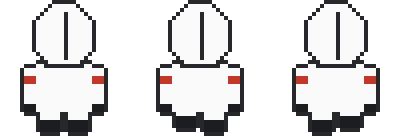 |
| `SCRIBE.high.right` | 16×17 | Cook (opus), walking right, 3 frames. Source: `ui/art/breakingbad/scribe.png` | 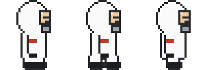 |
| `SCRIBE.high.left` | 16×17 | Cook (opus), walking left, 3 frames. Source: `ui/art/breakingbad/scribe.png` | 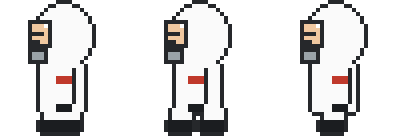 |
| `SCRIBE.standard.down` | 16×17 | Partner (sonnet), walking down, 3 frames. Source: `ui/art/breakingbad/scribe.png` | 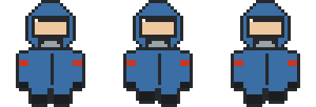 |
| `SCRIBE.standard.up` | 16×17 | Partner (sonnet), walking up, 3 frames. Source: `ui/art/breakingbad/scribe.png` | 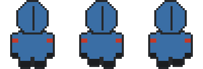 |
| `SCRIBE.standard.right` | 16×17 | Partner (sonnet), walking right, 3 frames. Source: `ui/art/breakingbad/scribe.png` | 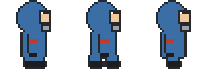 |
| `SCRIBE.standard.left` | 16×17 | Partner (sonnet), walking left, 3 frames. Source: `ui/art/breakingbad/scribe.png` | 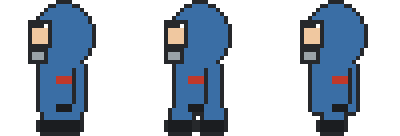 |
| `SCRIBE.novice.down` | 16×17 | Assistant (haiku), walking down, 3 frames. Source: `ui/art/breakingbad/scribe.png` | 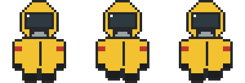 |
| `SCRIBE.novice.up` | 16×17 | Assistant (haiku), walking up, 3 frames. Source: `ui/art/breakingbad/scribe.png` | 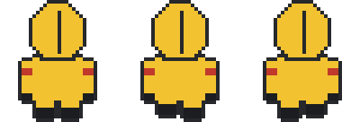 |
| `SCRIBE.novice.right` | 16×17 | Assistant (haiku), walking right, 3 frames. Source: `ui/art/breakingbad/scribe.png` | 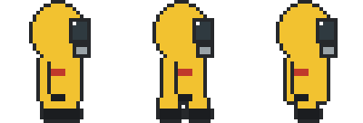 |
| `SCRIBE.novice.left` | 16×17 | Assistant (haiku), walking left, 3 frames. Source: `ui/art/breakingbad/scribe.png` | 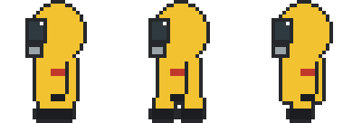 |
| `SCRIBE.sashes` | 16×17 | Department colours (theme sash), one per project. Source: `ui/art/breakingbad/scribe.png` | 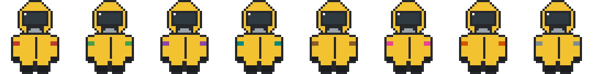 |

## Adept (one per subagent)

| Sprite | Logical size | Notes | Image |
|---|---|---|---|
| `ADEPT.high.down` | 12×14 | Cook adept, walking down, 3 frames. Source: `ui/art/breakingbad/adept.png` |  |
| `ADEPT.high.up` | 12×14 | Cook adept, walking up, 3 frames. Source: `ui/art/breakingbad/adept.png` | 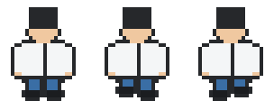 |
| `ADEPT.high.right` | 12×14 | Cook adept, walking right, 3 frames. Source: `ui/art/breakingbad/adept.png` | 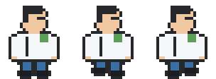 |
| `ADEPT.high.left` | 12×14 | Cook adept, walking left, 3 frames. Source: `ui/art/breakingbad/adept.png` | 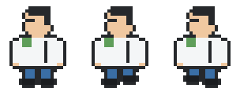 |
| `ADEPT.standard.down` | 12×14 | Partner adept, walking down, 3 frames. Source: `ui/art/breakingbad/adept.png` |  |
| `ADEPT.standard.up` | 12×14 | Partner adept, walking up, 3 frames. Source: `ui/art/breakingbad/adept.png` | 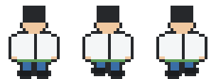 |
| `ADEPT.standard.right` | 12×14 | Partner adept, walking right, 3 frames. Source: `ui/art/breakingbad/adept.png` | 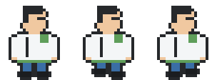 |
| `ADEPT.standard.left` | 12×14 | Partner adept, walking left, 3 frames. Source: `ui/art/breakingbad/adept.png` |  |
| `ADEPT.novice.down` | 12×14 | Assistant adept, walking down, 3 frames. Source: `ui/art/breakingbad/adept.png` |  |
| `ADEPT.novice.up` | 12×14 | Assistant adept, walking up, 3 frames. Source: `ui/art/breakingbad/adept.png` | 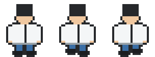 |
| `ADEPT.novice.right` | 12×14 | Assistant adept, walking right, 3 frames. Source: `ui/art/breakingbad/adept.png` |  |
| `ADEPT.novice.left` | 12×14 | Assistant adept, walking left, 3 frames. Source: `ui/art/breakingbad/adept.png` | 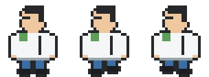 |
| `ADEPT.kinds` | 12×14 | Subagent kind glyphs (Explore, Plan, general-purpose, any other agent), facing down, then up. Source: `ui/art/breakingbad/adept.png` |  |

## Watchman (Night Vigil, while armed)

| Sprite | Logical size | Notes | Image |
|---|---|---|---|
| `WATCH.down` | 16×18 | The Watchman, walking down with his light, 3 frames. Source: `ui/art/breakingbad/watch.png` |  |
| `WATCH.up` | 16×18 | The Watchman, walking up with his light, 3 frames. Source: `ui/art/breakingbad/watch.png` | 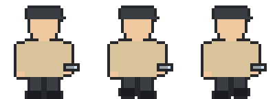 |
| `WATCH.right` | 16×18 | The Watchman, walking right with his light, 3 frames. Source: `ui/art/breakingbad/watch.png` | 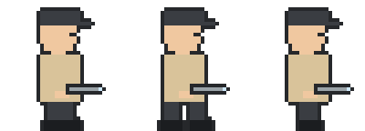 |
| `WATCH.left` | 16×18 | The Watchman, walking left with his light, 3 frames. Source: `ui/art/breakingbad/watch.png` | 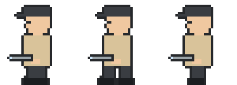 |
| `WATCH.ring` | 16×18 | The Watchman: his signal pose (bell, walkie-talkie, wrist panel, hourglass or whistle). Source: `ui/art/breakingbad/watch.png` |  |

## Magos (on the throne)

| Sprite | Logical size | Notes | Image |
|---|---|---|---|
| `MAGOS` | 24×24 | Seated Magos: the drill arm swings, the chest screen scans, the optics pulse (body and arm frames). Source: `ui/art/breakingbad/magos.png` | 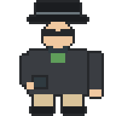 |
| `MAGOS.arm` | 5×24 | The drill forearm, its own frame so it can swing. Source: `ui/art/breakingbad/magos.png` |  |

## 39° characters

| Sprite | Logical size | Notes | Image |
|---|---|---|---|
| `SCRIBE39.E` | 16×17 | SCRIBE39, 39° view, walking E, 3 frames. Source: `ui/art/breakingbad/scribe39.png` | 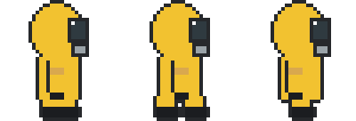 |
| `SCRIBE39.W` | 16×17 | SCRIBE39, 39° view, walking W, 3 frames. Source: `ui/art/breakingbad/scribe39.png` | 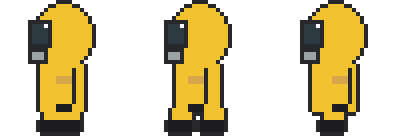 |
| `SCRIBE39.S` | 16×17 | SCRIBE39, 39° view, walking S, 3 frames. Source: `ui/art/breakingbad/scribe39.png` | 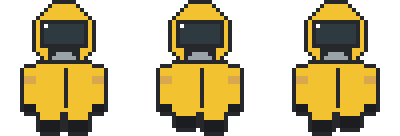 |
| `SCRIBE39.N` | 16×17 | SCRIBE39, 39° view, walking N, 3 frames. Source: `ui/art/breakingbad/scribe39.png` | 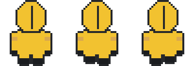 |
| `SCRIBE39.scroll` | 5×7 | SCRIBE39, scroll. Source: `ui/art/breakingbad/scribe39.png` |  |
| `ADEPT39.E` | 12×14 | ADEPT39, 39° view, walking E, 3 frames. Source: `ui/art/breakingbad/adept39.png` |  |
| `ADEPT39.W` | 12×14 | ADEPT39, 39° view, walking W, 3 frames. Source: `ui/art/breakingbad/adept39.png` |  |
| `ADEPT39.S` | 12×14 | ADEPT39, 39° view, walking S, 3 frames. Source: `ui/art/breakingbad/adept39.png` |  |
| `ADEPT39.N` | 12×14 | ADEPT39, 39° view, walking N, 3 frames. Source: `ui/art/breakingbad/adept39.png` |  |
| `ADEPT39.kinds` | 12×14 | Subagent kind glyphs (Explore, Plan, general-purpose, any other agent), facing S, then E, then N, then W. Source: `ui/art/breakingbad/adept39.png` |  |
| `MAGOS39.body` | 24×24 | MAGOS39, body. Source: `ui/art/breakingbad/magos39.png` | 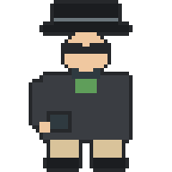 |
| `MAGOS39.arm` | 5×24 | MAGOS39, arm. Source: `ui/art/breakingbad/magos39.png` |  |
| `SKULL39.skull` | 10×10 | SKULL39, skull. Source: `ui/art/breakingbad/skull39.png` |  |
| `WATCH39.E` | 16×18 | WATCH39, 39° view, walking E, 3 frames. Source: `ui/art/breakingbad/watch39.png` |  |
| `WATCH39.W` | 16×18 | WATCH39, 39° view, walking W, 3 frames. Source: `ui/art/breakingbad/watch39.png` | 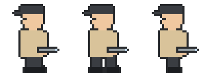 |
| `WATCH39.S` | 16×18 | WATCH39, 39° view, walking S, 3 frames. Source: `ui/art/breakingbad/watch39.png` | 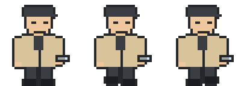 |
| `WATCH39.N` | 16×18 | WATCH39, 39° view, walking N, 3 frames. Source: `ui/art/breakingbad/watch39.png` |  |
| `WATCH39.ring` | 16×18 | WATCH39, ring. Source: `ui/art/breakingbad/watch39.png` | 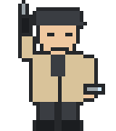 |

## Props and furniture

| Sprite | Logical size | Notes | Image |
|---|---|---|---|
| `DESK` | 32×21 | Scribe's desk: screen and candle lit while busy. Source: `ui/art/breakingbad/workstations.png`, drawn by scene.js | 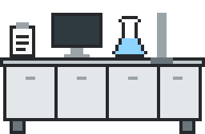 |
| `DESK.unlit` | 32×21 | DESK, unlit. Source: `ui/art/breakingbad/workstations.png` | 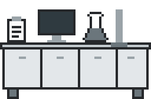 |
| `LECTERN` | 22×21 | Compact desk once the hall is full (6 a row). Source: `ui/art/breakingbad/workstations.png`, drawn by scene.js |  |
| `LECTERN.unlit` | 22×21 | LECTERN, unlit. Source: `ui/art/breakingbad/workstations.png` | 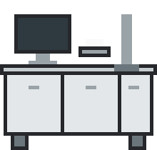 |
| `CONSOLE` | 14×10 | Adept console, one per subagent. Source: `ui/art/breakingbad/workstations.png`, drawn by scene.js |  |
| `CONSOLE.unlit` | 14×10 | CONSOLE, unlit. Source: `ui/art/breakingbad/workstations.png` |  |
| `COGITATOR` | 82×50 | Cogitator bank on the back wall: where shell commands run. Source: `ui/art/breakingbad/cogitator.png`, drawn by scene.js, scene39.js | 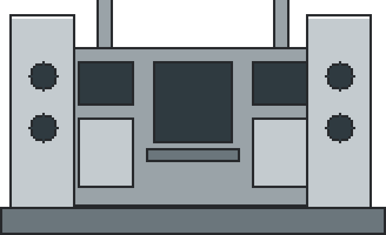 |
| `THRONE` | 20×20 | The Magos's throne (Sanctum). Source: `ui/art/breakingbad/sanctum.png`, drawn by scene.js | 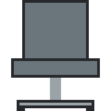 |
| `LORD_DESK` | 44×13 | The Magos's desk, petitions queue before it. Source: `ui/art/breakingbad/sanctum.png`, drawn by scene.js |  |
| `COG_MECH` | 20×18 | Cog Mechanicus above the throne. Source: `ui/art/breakingbad/sanctum.png`, drawn by scene.js | 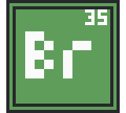 |
| `SEAL` | 6×10 | Purity seals on the lord desk. Source: `ui/art/breakingbad/sanctum.png`, drawn by scene.js |  |
| `GATE` | 32×30 | Grand gate frame: sessions enter and leave here. Source: `ui/art/breakingbad/gate.png`, drawn by isohall.js, scene.js | 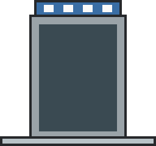 |
| `GATE_L` | 8×22 | Grand gate, left leaf (slides open). Source: `ui/art/breakingbad/gate.png`, drawn by scene.js, scene39.js | 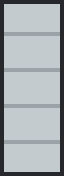 |
| `GATE_R` | 8×22 | Grand gate, right leaf (slides open). Source: `ui/art/breakingbad/gate.png`, drawn by scene.js, scene39.js |  |
| `GATE_VOID` | 16×22 | Grand gate, the ember-lit void beyond the leaves. Source: `ui/art/breakingbad/gate.png`, drawn by scene.js, scene39.js | 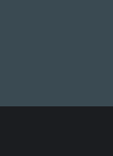 |
| `RECAFF` | 16×18 | Recaff dispenser (Refectorium), first stop of an idle scribe. Source: `ui/art/breakingbad/refectorium.png`, drawn by scene.js |  |
| `TABLE` | 46×8 | Refectorium table. Source: `ui/art/breakingbad/refectorium.png`, drawn by scene.js |  |
| `BENCH` | 46×4 | Refectorium bench: long-idle scribes sleep here. Source: `ui/art/breakingbad/refectorium.png`, drawn by scene.js |  |
| `WINDOW` | 16×17 | Window: day or night glass, casts a beam by day. Source: `ui/art/breakingbad/walls.png`, drawn by scene.js, theme.js, wallart.js | 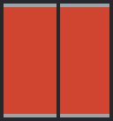 |
| `WINDOW.day` | 16×17 | WINDOW, day. Source: `ui/art/breakingbad/walls.png` | 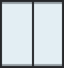 |
| `WINDOW.night` | 16×17 | WINDOW, night. Source: `ui/art/breakingbad/walls.png` | 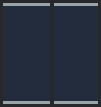 |
| `BANNER` | 12×15 | Wall banner (the Sanctum wall; the back walls of a world without its own hangings). Source: `ui/art/breakingbad/walls.png`, drawn by isohall.js, scene.js, wallart.js | 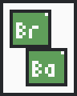 |
| `SHELF` | 32×21 | Bookshelf on the back wall. Source: `ui/art/breakingbad/walls.png`, drawn by isohall.js, scene.js, wallart.js | 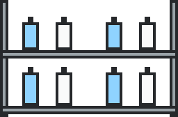 |
| `GAUGE` | 6×6 | Pressure gauge on the Sanctum pillars. Source: `ui/art/breakingbad/walls.png`, drawn by scene.js |  |
| `CENSER` | 5×10 | Censer. Source: `ui/art/breakingbad/walls.png`, drawn by scene.js |  |
| `WINDOW_TALL` | 18×42 | Tall gothic window on the back walls: day or night glass, casts a beam by day. Source: `ui/art/breakingbad/walls.png`, drawn by wallart.js | 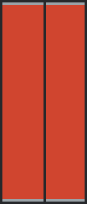 |
| `WINDOW_TALL.day` | 18×42 | WINDOW_TALL, day. Source: `ui/art/breakingbad/walls.png` |  |
| `WINDOW_TALL.night` | 18×42 | WINDOW_TALL, night. Source: `ui/art/breakingbad/walls.png` |  |
| `HANGING` | 13×50 | Full-height hanging on the back walls. Source: `ui/art/breakingbad/walls.png`, drawn by isohall.js, scene.js, wallart.js | 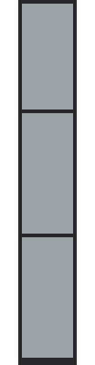 |
| `HANGING_B` | 13×50 | Second full-height hanging (aquila and litany scroll), every other one on the back walls. Source: `ui/art/breakingbad/walls.png`, drawn by wallart.js | 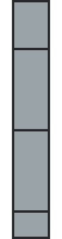 |
| `SHELF_B` | 32×21 | Second back-wall shelf (scroll cubbies, a skull niche, reliquary caskets), every other one on the back walls. Source: `ui/art/breakingbad/walls.png`, drawn by isohall.js, scene.js, wallart.js | 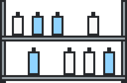 |
| `PAPER_STACK` | 8×12 | Paper tower (decor). Source: `ui/art/breakingbad/clutter.png`, drawn by scene.js | 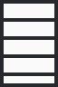 |
| `SCROLL_PILE` | 18×7 | Scroll pile (decor). Source: `ui/art/breakingbad/clutter.png`, drawn by scene.js |  |
| `BOOKS` | 10×9 | Book pile (decor). Source: `ui/art/breakingbad/clutter.png`, drawn by scene.js |  |
| `LOOSE_A` | 5×4 | Loose sheet on the floor (decor). Source: `ui/art/breakingbad/clutter.png`, drawn by scene.js |  |
| `LOOSE_B` | 4×5 | Loose sheet on the floor (decor). Source: `ui/art/breakingbad/clutter.png`, drawn by scene.js |  |
| `CRATE` | 14×12 | Supply crate. Source: `ui/art/breakingbad/clutter.png`, drawn by scene.js |  |
| `SKULL` | 10×10 | Servo-skull: perched by the Magos, courier on git push, red-eyed over a stale petition. Source: `ui/art/breakingbad/skull.png`, drawn by scene.js, scene39.js |  |
| `SKULL.alarm` | 10×10 | SKULL, alarm. Source: `ui/art/breakingbad/skull.png` |  |
| `SCROLL` | 6×7 | Sealed petition scroll, held while queued in the Sanctum. Source: `ui/art/breakingbad/petitions.png`, drawn by actors.js |  |
| `QSCROLL` | 6×7 | Question scroll: the turn ended with a question. Source: `ui/art/breakingbad/petitions.png`, drawn by actors.js |  |
| `SCROLL_HELD` | 14×7 | The finished scroll a scribe raises when a long turn is done. Source: `ui/art/breakingbad/petitions.png`, drawn by actors.js |  |
| `BRAZIER` | 10×13 | Brazier at the gate and in the Sanctum; compaction burns here. Source: `ui/art/breakingbad/fire.png`, drawn by scene.js, scene39.js |  |
| `CANDLES` | 12×9 | Candle cluster. Source: `ui/art/breakingbad/fire.png`, drawn by scene.js |  |
| `COMMIT_SEAL` | 4×7.5 | Purity seal hung on the desk for each commit (up to 3). Source: `ui/art/breakingbad/commits.png`, drawn by scene.js |  |
| `COMMIT_TAG` | 4×7.5 | The seal's strips before the wax lands. Source: `ui/art/breakingbad/commits.png`, drawn by scene.js |  |
| `COMMIT_STAMP` | 4×6 | The stamp that seals a commit. Source: `ui/art/breakingbad/commits.png`, drawn by scene.js |  |
| `BREAKOUT_FLOOR` | 8×8 | Break-out room floor tile (temp-folder sessions). Source: `ui/art/breakingbad/breakout.png`, drawn by scene.js |  |
| `BREAKOUT_RAIL` | 8×5 | Break-out room rail, front and back edges. Source: `ui/art/breakingbad/breakout.png`, drawn by scene.js, scene39.js |  |
| `BREAKOUT_SIDE` | 2×8 | Break-out room side rail, seen from above. Source: `ui/art/breakingbad/breakout.png`, drawn by scene.js |  |
| `BREAKOUT_POST` | 3×7 | Break-out room post: corners and beside each gate. Source: `ui/art/breakingbad/breakout.png`, drawn by scene.js |  |
| `BREAKOUT_GATE` | 2×8 | Break-out room gate, closed, in the side. Source: `ui/art/breakingbad/breakout.png`, drawn by scene.js |  |
| `BREAKOUT_GATE_OPEN` | 8×5 | Break-out room gate leaf, swung open. Source: `ui/art/breakingbad/breakout.png`, drawn by scene.js |  |
| `BREAKOUT_GATE_FRONT` | 8×10 | Break-out room gate facing the viewer (strip, 39° view). Source: `ui/art/breakingbad/breakout.png`, drawn by scene.js, scene39.js |  |
| `BREAKOUT_GATE_FRONT_OPEN` | 8×10 | Break-out room gate facing the viewer, open. Source: `ui/art/breakingbad/breakout.png`, drawn by scene.js |  |
| `DAIS` | 40×27 | Suzerain dais under a desk: a session that forked live child sessions. Source: `ui/art/breakingbad/suzerain.png`, drawn by scene.js |  |
| `DAIS_C` | 30×27 | Suzerain dais under a lectern (crowded hall). Source: `ui/art/breakingbad/suzerain.png`, drawn by scene.js |  |
| `LINK_H` | 4×3 | Suzerain link tile, across: from the dais to a forked child. Source: `ui/art/breakingbad/suzerain.png`, drawn by (not referenced by name) |  |
| `LINK_V` | 3×4 | Suzerain link tile, down. Source: `ui/art/breakingbad/suzerain.png`, drawn by (not referenced by name) |  |
| `LINK_END` | 5×4 | Suzerain link end at the child's feet. Source: `ui/art/breakingbad/suzerain.png`, drawn by (not referenced by name) |  |
| `BRAZIER.fire` | 10×14 | BRAZIER: the flame licking, 4 frames (still, BRAZIER_FIRE_1 over it, still, BRAZIER_FIRE_2). Source: `ui/art/breakingbad/fire.png` |  |
| `CANDLES.fire` | 12×9.5 | CANDLES: the flame licking, 4 frames (still, CANDLES_FIRE_1 over it, still, CANDLES_FIRE_2). Source: `ui/art/breakingbad/fire.png` |  |
| `DOZE_Z` | 3.5×3.5 | The Z drifting up over a dozing scribe (on the bench, or idle at the desk), drawn twice, fading. Source: `ui/art/breakingbad/refectorium.png`, drawn by actors.js |  |
| `SHELL_COG` | 6×6 | Cog turning on a desk corner while a background shell runs, 16 frames a revolution (~3 s). Source: `ui/art/breakingbad/workstations.png`, drawn by (not referenced by name) |  |
| `HONOURS` | 36×48 | Hall of Honours plaque in the scriptorium's first back-wall alcove (a wide hall): the week's four marks are written over it. Source: `ui/art/breakingbad/honours.png`, drawn by scene.js |  |

## Room tiles

| Sprite | Logical size | Notes | Image |
|---|---|---|---|
| `ROOM.floor` | 32×16 | `floor`: repeats both ways, mixed with `floor vent`, `floor bolts` (shown repeated). Source: `ui/art/breakingbad/room-floor.png` |  |
| `ROOM.channel_h` | 24×2 | `channel h`: repeats along x, glows (coolant) (shown repeated). Source: `ui/art/breakingbad/room-floor.png` |  |
| `ROOM.channel_v` | 2×24 | `channel v`: repeats along y, glows (coolant) (shown repeated). Source: `ui/art/breakingbad/room-floor.png` |  |
| `ROOM.sanctum_passage` | 6×6 | `sanctum passage`: repeats both ways (shown repeated). Source: `ui/art/breakingbad/room-floor.png` |  |
| `ROOM.sill` | 72×2 | `sill`: repeats along x (shown repeated). Source: `ui/art/breakingbad/room-floor.png` |  |
| `ROOM.sanctum_floor` | 20×20 | `sanctum floor`: nine-slice (corners kept, edges and centre repeat). Source: `ui/art/breakingbad/room-floor.png` |  |
| `ROOM.wall_top` | 12×10 | `wall top`: drawn as is. Source: `ui/art/breakingbad/room-walls.png` |  |
| `ROOM.wall` | 36×30 | `wall`: repeats both ways, first row from `wall top` (shown repeated). Source: `ui/art/breakingbad/room-walls.png` |  |
| `ROOM.wall_east_top` | 12×10 | `wall east top`: drawn as is. Source: `ui/art/breakingbad/room-walls.png` |  |
| `ROOM.wall_east` | 36×30 | `wall east`: repeats both ways, first row from `wall east top` (shown repeated). Source: `ui/art/breakingbad/room-walls.png` |  |
| `ROOM.wall_sanctum_top` | 12×10 | `wall sanctum top`: drawn as is. Source: `ui/art/breakingbad/room-walls.png` |  |
| `ROOM.wall_sanctum` | 36×30 | `wall sanctum`: repeats both ways, first row from `wall sanctum top` (shown repeated). Source: `ui/art/breakingbad/room-walls.png` |  |
| `ROOM.wall_foot` | 6×6 | `wall foot`: repeats both ways (shown repeated). Source: `ui/art/breakingbad/room-walls.png` |  |
| `ROOM.wall_dark` | 6×6 | `wall dark`: repeats both ways (shown repeated). Source: `ui/art/breakingbad/room-walls.png` |  |
| `ROOM.wall_base` | 12×3 | `wall base`: repeats along x (shown repeated). Source: `ui/art/breakingbad/room-walls.png` |  |
| `ROOM.sanctum_base` | 12×3 | `sanctum base`: repeats along x (shown repeated). Source: `ui/art/breakingbad/room-walls.png` |  |
| `ROOM.pillar` | 10×24 | `pillar`: repeats along y (shown repeated). Source: `ui/art/breakingbad/room-walls.png` |  |
| `ROOM.pilaster` | 4×19.5 | `pilaster`: drawn as is. Source: `ui/art/breakingbad/room-walls.png` |  |
| `ROOM.beacon_off` | 7×10 | `beacon off`: drawn as is. Source: `ui/art/breakingbad/room-walls.png` |  |
| `ROOM.beacon_on` | 7×10 | `beacon on`: drawn as is. Source: `ui/art/breakingbad/room-walls.png` |  |
| `ROOM.beacon_cage` | 7×10 | `beacon cage`: drawn as is. Source: `ui/art/breakingbad/room-walls.png` |  |
| `ROOM.pipe_h` | 24×3 | `pipe h`: repeats along x (shown repeated). Source: `ui/art/breakingbad/room-pipes.png` |  |
| `ROOM.pipe_v` | 3×24 | `pipe v`: repeats along y (shown repeated). Source: `ui/art/breakingbad/room-pipes.png` |  |
| `ROOM.fitting_h` | 3×5 | `fitting h`: drawn as is. Source: `ui/art/breakingbad/room-pipes.png` |  |
| `ROOM.fitting_v` | 5×3 | `fitting v`: drawn as is. Source: `ui/art/breakingbad/room-pipes.png` |  |
| `ROOM.fitting_wide` | 10×2 | `fitting wide`: drawn as is. Source: `ui/art/breakingbad/room-pipes.png` |  |
| `ROOM.door_sanctum_closed` | 10×40 | `door sanctum closed`: drawn as is. Source: `ui/art/breakingbad/room-doors.png` |  |
| `ROOM.door_sanctum_half` | 10×40 | `door sanctum half`: drawn as is. Source: `ui/art/breakingbad/room-doors.png` |  |
| `ROOM.door_sanctum_open` | 10×40 | `door sanctum open`: drawn as is. Source: `ui/art/breakingbad/room-doors.png` |  |
| `ROOM.door_refectory_closed` | 10×24 | `door refectory closed`: drawn as is. Source: `ui/art/breakingbad/room-doors.png` |  |
| `ROOM.door_refectory_half` | 10×24 | `door refectory half`: drawn as is. Source: `ui/art/breakingbad/room-doors.png` |  |
| `ROOM.door_refectory_open` | 10×24 | `door refectory open`: drawn as is. Source: `ui/art/breakingbad/room-doors.png` |  |

## Face sheets (39° side and top faces)

| Sprite | Logical size | Notes | Image |
|---|---|---|---|
| `FACES.DESK` | 32×5 | DESK, 39° view only: top. Source: `ui/art/breakingbad/faces.png` |  |
| `FACES.LECTERN` | 22×4.5 | LECTERN, 39° view only: top. Source: `ui/art/breakingbad/faces.png` |  |

## Desktop column (lift)

| Sprite | Logical size | Notes | Image |
|---|---|---|---|
| `SHAFT` | 28×8 | Desktop column: the lift shaft, tiled down the inner side. Source: `ui/art/breakingbad/lift.png` |  |
| `SHAFT_TOP` | 28×6 | Desktop column: the head of the lift shaft (its pulley). Source: `ui/art/breakingbad/lift.png` |  |
| `SHAFT_PIT` | 28×4 | Desktop column: the foot of the lift shaft. Source: `ui/art/breakingbad/lift.png` |  |
| `CABLE` | 1×2 | Desktop column: the lift cable from the shaft head down to the car, tiled. Source: `ui/art/breakingbad/lift.png` |  |
| `CAR_BACK` | 26×20 | Desktop column: the lift car behind its riders. Source: `ui/art/breakingbad/lift.png` |  |
| `CAR_FRONT.shut` | 26×20 | Desktop column: the lift car front over its riders, doors shut. Source: `ui/art/breakingbad/lift.png` |  |
| `CAR_FRONT.half` | 26×20 | Desktop column: the lift car front, doors half open. Source: `ui/art/breakingbad/lift.png` |  |
| `CAR_FRONT.open` | 26×20 | Desktop column: the lift car front, doors open. Source: `ui/art/breakingbad/lift.png` |  |
| `SLAB` | 8×6 | Desktop column: the floor slab under each floor line, tiled. Source: `ui/art/breakingbad/lift.png` |  |
| `SLAB_L` | 4×6 | Desktop column: the floor slab, left end. Source: `ui/art/breakingbad/lift.png` |  |
| `SLAB_R` | 4×6 | Desktop column: the floor slab, right end. Source: `ui/art/breakingbad/lift.png` |  |
| `LAMP.off` | 3×3 | Desktop column: the call lamp by a landing, dark. Source: `ui/art/breakingbad/lift.png` |  |
| `LAMP.on` | 3×3 | Desktop column: the call lamp, lit while someone waits there or the car stands open. Source: `ui/art/breakingbad/lift.png` |  |

## Custom rooms

| Sprite | Logical size | Notes | Image |
|---|---|---|---|
| `ENCLAVE_FLOOR` | 8×8 | Custom room floor tile (Settings > Rooms); its sash parts take the rule colour. Source: `ui/art/breakingbad/enclave.png` |  |
| `ENCLAVE_RAIL` | 8×5 | Custom room rail, front and back edges. Source: `ui/art/breakingbad/enclave.png` |  |
| `ENCLAVE_SIDE` | 2×8 | Custom room side rail, seen from above. Source: `ui/art/breakingbad/enclave.png` |  |
| `ENCLAVE_POST` | 3×7 | Custom room post: corners and beside each gate. Source: `ui/art/breakingbad/enclave.png` |  |
| `ENCLAVE_GATE` | 2×8 | Custom room gate, closed, in the side. Source: `ui/art/breakingbad/enclave.png` |  |
| `ENCLAVE_GATE_OPEN` | 8×5 | Custom room gate leaf, swung open. Source: `ui/art/breakingbad/enclave.png` |  |
| `ENCLAVE_GATE_FRONT` | 8×10 | Custom room gate facing the viewer (strip, 39° view). Source: `ui/art/breakingbad/enclave.png` |  |
| `ENCLAVE_GATE_FRONT_OPEN` | 8×10 | Custom room gate facing the viewer, open. Source: `ui/art/breakingbad/enclave.png` |  |
