# Sprites — Darwin

Generated by `node tools/sprite_sheet.mjs --theme darwin` from the art files in `ui/art/` and the palette in `ui/theme.js`. Do not edit by hand.
Each image is 4× the art pixels (the art is 2× the logical scene pixels). Sizes are logical px.

To browse every theme side by side, animated and zoomable, open the live viewer `tools/sprites.html` (see its header).
To discuss a sprite, open a **Sprite** issue (New issue → Sprite) and paste the sprite id; see
[the design note](../superpowers/specs/2026-10-06-sprite-themes-design.md#discussing-sprites).

## Scribe (one per session)

| Sprite | Logical size | Notes | Image |
|---|---|---|---|
| `SCRIBE.high.down` | 16×17 | Orang-utan (opus), walking down, 3 frames. Source: `ui/art/darwin/scribe.png` | 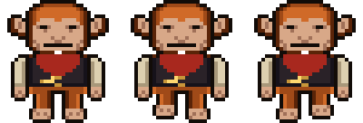 |
| `SCRIBE.high.up` | 16×17 | Orang-utan (opus), walking up, 3 frames. Source: `ui/art/darwin/scribe.png` | 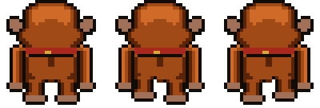 |
| `SCRIBE.high.right` | 16×17 | Orang-utan (opus), walking right, 3 frames. Source: `ui/art/darwin/scribe.png` | 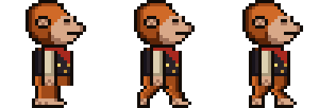 |
| `SCRIBE.high.left` | 16×17 | Orang-utan (opus), walking left, 3 frames. Source: `ui/art/darwin/scribe.png` | 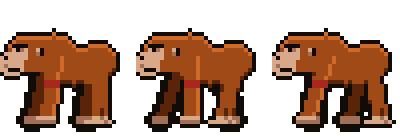 |
| `SCRIBE.standard.down` | 16×17 | Chimpanzee (sonnet), walking down, 3 frames. Source: `ui/art/darwin/scribe.png` | 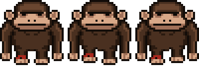 |
| `SCRIBE.standard.up` | 16×17 | Chimpanzee (sonnet), walking up, 3 frames. Source: `ui/art/darwin/scribe.png` | 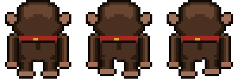 |
| `SCRIBE.standard.right` | 16×17 | Chimpanzee (sonnet), walking right, 3 frames. Source: `ui/art/darwin/scribe.png` | 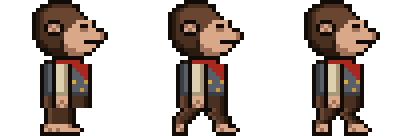 |
| `SCRIBE.standard.left` | 16×17 | Chimpanzee (sonnet), walking left, 3 frames. Source: `ui/art/darwin/scribe.png` | 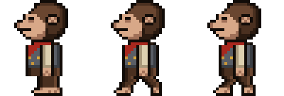 |
| `SCRIBE.novice.down` | 16×17 | Young monkey (haiku), walking down, 3 frames. Source: `ui/art/darwin/scribe.png` | 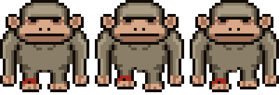 |
| `SCRIBE.novice.up` | 16×17 | Young monkey (haiku), walking up, 3 frames. Source: `ui/art/darwin/scribe.png` | 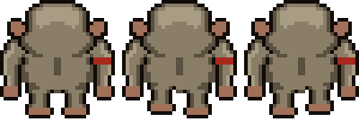 |
| `SCRIBE.novice.right` | 16×17 | Young monkey (haiku), walking right, 3 frames. Source: `ui/art/darwin/scribe.png` | 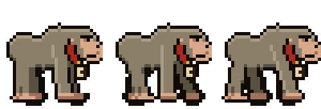 |
| `SCRIBE.novice.left` | 16×17 | Young monkey (haiku), walking left, 3 frames. Source: `ui/art/darwin/scribe.png` | 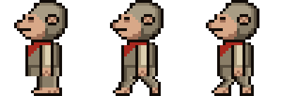 |
| `SCRIBE.sashes` | 16×17 | Department colours (theme sash), one per project. Source: `ui/art/darwin/scribe.png` | 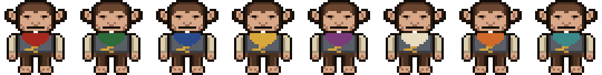 |

## Adept (one per subagent)

| Sprite | Logical size | Notes | Image |
|---|---|---|---|
| `ADEPT.high.down` | 12×14 | Orang-utan adept, walking down, 3 frames. Source: `ui/art/darwin/adept.png` | 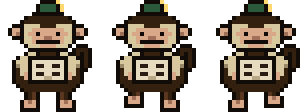 |
| `ADEPT.high.up` | 12×14 | Orang-utan adept, walking up, 3 frames. Source: `ui/art/darwin/adept.png` | 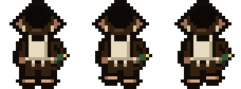 |
| `ADEPT.high.right` | 12×14 | Orang-utan adept, walking right, 3 frames. Source: `ui/art/darwin/adept.png` | 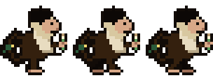 |
| `ADEPT.high.left` | 12×14 | Orang-utan adept, walking left, 3 frames. Source: `ui/art/darwin/adept.png` | 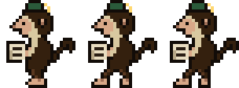 |
| `ADEPT.standard.down` | 12×14 | Chimpanzee adept, walking down, 3 frames. Source: `ui/art/darwin/adept.png` | 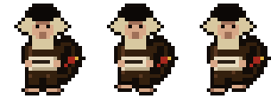 |
| `ADEPT.standard.up` | 12×14 | Chimpanzee adept, walking up, 3 frames. Source: `ui/art/darwin/adept.png` | 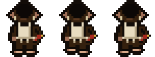 |
| `ADEPT.standard.right` | 12×14 | Chimpanzee adept, walking right, 3 frames. Source: `ui/art/darwin/adept.png` | 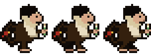 |
| `ADEPT.standard.left` | 12×14 | Chimpanzee adept, walking left, 3 frames. Source: `ui/art/darwin/adept.png` | 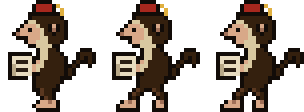 |
| `ADEPT.novice.down` | 12×14 | Young monkey adept, walking down, 3 frames. Source: `ui/art/darwin/adept.png` | 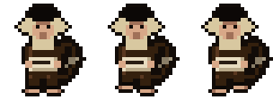 |
| `ADEPT.novice.up` | 12×14 | Young monkey adept, walking up, 3 frames. Source: `ui/art/darwin/adept.png` | 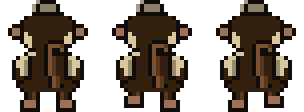 |
| `ADEPT.novice.right` | 12×14 | Young monkey adept, walking right, 3 frames. Source: `ui/art/darwin/adept.png` | 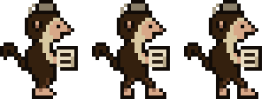 |
| `ADEPT.novice.left` | 12×14 | Young monkey adept, walking left, 3 frames. Source: `ui/art/darwin/adept.png` | 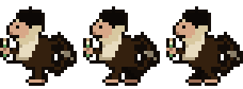 |

## Watchman (Night Vigil, while armed)

| Sprite | Logical size | Notes | Image |
|---|---|---|---|
| `WATCH.down` | 16×18 | The Watchman, walking down with his light, 3 frames. Source: `ui/art/darwin/watch.png` | 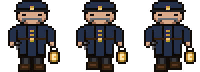 |
| `WATCH.up` | 16×18 | The Watchman, walking up with his light, 3 frames. Source: `ui/art/darwin/watch.png` | 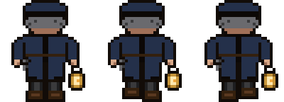 |
| `WATCH.right` | 16×18 | The Watchman, walking right with his light, 3 frames. Source: `ui/art/darwin/watch.png` | 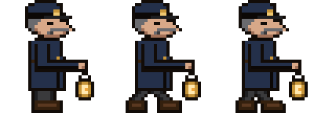 |
| `WATCH.left` | 16×18 | The Watchman, walking left with his light, 3 frames. Source: `ui/art/darwin/watch.png` | 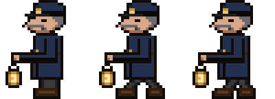 |
| `WATCH.ring` | 16×18 | The Watchman: his signal pose (bell, walkie-talkie, wrist panel, hourglass or whistle). Source: `ui/art/darwin/watch.png` | 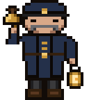 |

## Magos (on the throne)

| Sprite | Logical size | Notes | Image |
|---|---|---|---|
| `MAGOS` | 24×24 | Seated Magos: the drill arm swings, the chest screen scans, the optics pulse (body and arm frames). Source: `ui/art/darwin/magos.png` | 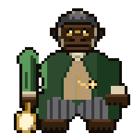 |
| `MAGOS.arm` | 5×24 | The drill forearm, its own frame so it can swing. Source: `ui/art/darwin/magos.png` |  |

## 39° characters

| Sprite | Logical size | Notes | Image |
|---|---|---|---|
| `SCRIBE39.E` | 16×17 | SCRIBE39, 39° view, walking E, 3 frames. Source: `ui/art/darwin/scribe39.png` | 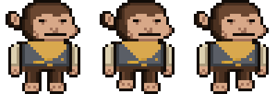 |
| `SCRIBE39.W` | 16×17 | SCRIBE39, 39° view, walking W, 3 frames. Source: `ui/art/darwin/scribe39.png` | 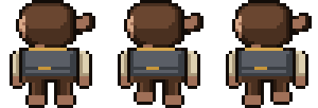 |
| `SCRIBE39.S` | 16×17 | SCRIBE39, 39° view, walking S, 3 frames. Source: `ui/art/darwin/scribe39.png` | 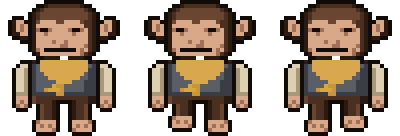 |
| `SCRIBE39.N` | 16×17 | SCRIBE39, 39° view, walking N, 3 frames. Source: `ui/art/darwin/scribe39.png` | 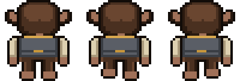 |
| `SCRIBE39.arm` | 5×8 | SCRIBE39, arm. Source: `ui/art/darwin/scribe39.png` | 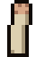 |
| `SCRIBE39.armL` | 4×8 | SCRIBE39, armL. Source: `ui/art/darwin/scribe39.png` | 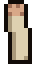 |
| `SCRIBE39.scroll` | 5×7 | SCRIBE39, scroll. Source: `ui/art/darwin/scribe39.png` |  |
| `ADEPT39.E` | 12×14 | ADEPT39, 39° view, walking E, 3 frames. Source: `ui/art/darwin/adept39.png` | 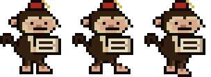 |
| `ADEPT39.W` | 12×14 | ADEPT39, 39° view, walking W, 3 frames. Source: `ui/art/darwin/adept39.png` | 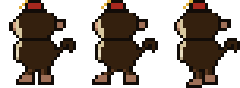 |
| `ADEPT39.S` | 12×14 | ADEPT39, 39° view, walking S, 3 frames. Source: `ui/art/darwin/adept39.png` |  |
| `ADEPT39.N` | 12×14 | ADEPT39, 39° view, walking N, 3 frames. Source: `ui/art/darwin/adept39.png` | 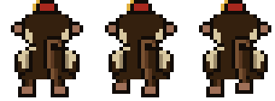 |
| `MAGOS39.body` | 24×24 | MAGOS39, body. Source: `ui/art/darwin/magos39.png` | 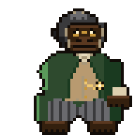 |
| `MAGOS39.arm` | 5×24 | MAGOS39, arm. Source: `ui/art/darwin/magos39.png` |  |
| `SKULL39.skull` | 10×10 | SKULL39, skull. Source: `ui/art/darwin/skull39.png` |  |
| `WATCH39.E` | 16×18 | WATCH39, 39° view, walking E, 3 frames. Source: `ui/art/darwin/watch39.png` | 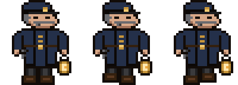 |
| `WATCH39.W` | 16×18 | WATCH39, 39° view, walking W, 3 frames. Source: `ui/art/darwin/watch39.png` | 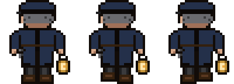 |
| `WATCH39.S` | 16×18 | WATCH39, 39° view, walking S, 3 frames. Source: `ui/art/darwin/watch39.png` | 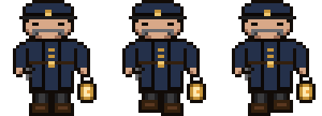 |
| `WATCH39.N` | 16×18 | WATCH39, 39° view, walking N, 3 frames. Source: `ui/art/darwin/watch39.png` | 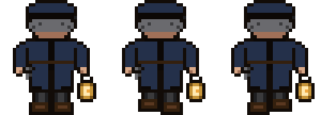 |
| `WATCH39.ring` | 16×18 | WATCH39, ring. Source: `ui/art/darwin/watch39.png` |  |

## Props and furniture

| Sprite | Logical size | Notes | Image |
|---|---|---|---|
| `ARM` | 4×8 | Scribe's right arm at the desk (raised with the scroll when a long turn finishes). Source: `ui/art/darwin/scribe.png`, drawn by actors.js | 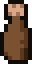 |
| `ARM_L` | 4×8 | Scribe's left arm at the desk. Source: `ui/art/darwin/scribe.png`, drawn by actors.js | 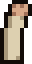 |
| `DESK` | 32×21 | Scribe's desk: screen and candle lit while busy. Source: `ui/art/darwin/workstations.png`, drawn by scene.js | 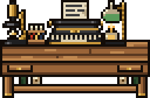 |
| `DESK.unlit` | 32×21 | DESK, unlit. Source: `ui/art/darwin/workstations.png` | 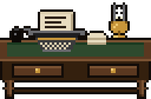 |
| `LECTERN` | 22×21 | Compact desk once the hall is full (6 a row). Source: `ui/art/darwin/workstations.png`, drawn by scene.js |  |
| `LECTERN.unlit` | 22×21 | LECTERN, unlit. Source: `ui/art/darwin/workstations.png` | 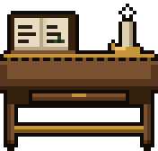 |
| `CONSOLE` | 14×10 | Adept console, one per subagent. Source: `ui/art/darwin/workstations.png`, drawn by scene.js |  |
| `CONSOLE.unlit` | 14×10 | CONSOLE, unlit. Source: `ui/art/darwin/workstations.png` |  |
| `COGITATOR` | 82×50 | Cogitator bank on the back wall: where shell commands run. Source: `ui/art/darwin/cogitator.png`, drawn by scene.js, scene39.js |  |
| `THRONE` | 20×20 | The Magos's throne (Sanctum). Source: `ui/art/darwin/sanctum.png`, drawn by scene.js |  |
| `LORD_DESK` | 44×13 | The Magos's desk, petitions queue before it. Source: `ui/art/darwin/sanctum.png`, drawn by scene.js |  |
| `COG_MECH` | 20×18 | Cog Mechanicus above the throne. Source: `ui/art/darwin/sanctum.png`, drawn by scene.js |  |
| `SEAL` | 6×10 | Purity seals on the lord desk. Source: `ui/art/darwin/sanctum.png`, drawn by scene.js |  |
| `GATE` | 32×30 | Grand gate frame: sessions enter and leave here. Source: `ui/art/darwin/gate.png`, drawn by isohall.js, scene.js |  |
| `GATE_L` | 8×22 | Grand gate, left leaf (slides open). Source: `ui/art/darwin/gate.png`, drawn by scene.js, scene39.js |  |
| `GATE_R` | 8×22 | Grand gate, right leaf (slides open). Source: `ui/art/darwin/gate.png`, drawn by scene.js, scene39.js |  |
| `GATE_VOID` | 16×22 | Grand gate, the ember-lit void beyond the leaves. Source: `ui/art/darwin/gate.png`, drawn by scene.js, scene39.js |  |
| `RECAFF` | 16×18 | Recaff dispenser (Refectorium), first stop of an idle scribe. Source: `ui/art/darwin/refectorium.png`, drawn by scene.js |  |
| `TABLE` | 46×8 | Refectorium table. Source: `ui/art/darwin/refectorium.png`, drawn by scene.js |  |
| `BENCH` | 46×4 | Refectorium bench: long-idle scribes sleep here. Source: `ui/art/darwin/refectorium.png`, drawn by scene.js |  |
| `WINDOW` | 16×17 | Window: day or night glass, casts a beam by day. Source: `ui/art/darwin/walls.png`, drawn by scene.js, theme.js, wallart.js |  |
| `WINDOW.day` | 16×17 | WINDOW, day. Source: `ui/art/darwin/walls.png` |  |
| `WINDOW.night` | 16×17 | WINDOW, night. Source: `ui/art/darwin/walls.png` |  |
| `BANNER` | 12×15 | Wall banner (the Sanctum wall; the back walls of a world without its own hangings). Source: `ui/art/darwin/walls.png`, drawn by isohall.js, scene.js, wallart.js |  |
| `SHELF` | 32×21 | Bookshelf on the back wall. Source: `ui/art/darwin/walls.png`, drawn by isohall.js, scene.js, wallart.js |  |
| `GAUGE` | 6×6 | Pressure gauge on the Sanctum pillars. Source: `ui/art/darwin/walls.png`, drawn by scene.js |  |
| `CENSER` | 5×10 | Censer. Source: `ui/art/darwin/walls.png`, drawn by scene.js |  |
| `WINDOW_TALL` | 18×42 | Tall gothic window on the back walls: day or night glass, casts a beam by day. Source: `ui/art/darwin/walls.png`, drawn by wallart.js |  |
| `WINDOW_TALL.day` | 18×42 | WINDOW_TALL, day. Source: `ui/art/darwin/walls.png` |  |
| `WINDOW_TALL.night` | 18×42 | WINDOW_TALL, night. Source: `ui/art/darwin/walls.png` |  |
| `HANGING` | 13×50 | Full-height hanging on the back walls. Source: `ui/art/darwin/walls.png`, drawn by isohall.js, scene.js, wallart.js |  |
| `PAPER_STACK` | 8×12 | Paper tower (decor). Source: `ui/art/darwin/clutter.png`, drawn by scene.js |  |
| `SCROLL_PILE` | 18×7 | Scroll pile (decor). Source: `ui/art/darwin/clutter.png`, drawn by scene.js |  |
| `BOOKS` | 10×9 | Book pile (decor). Source: `ui/art/darwin/clutter.png`, drawn by scene.js |  |
| `LOOSE_A` | 5×4 | Loose sheet on the floor (decor). Source: `ui/art/darwin/clutter.png`, drawn by scene.js |  |
| `LOOSE_B` | 4×5 | Loose sheet on the floor (decor). Source: `ui/art/darwin/clutter.png`, drawn by scene.js |  |
| `CRATE` | 14×12 | Supply crate. Source: `ui/art/darwin/clutter.png`, drawn by scene.js |  |
| `SKULL` | 10×10 | Servo-skull: perched by the Magos, courier on git push, red-eyed over a stale petition. Source: `ui/art/darwin/skull.png`, drawn by scene.js, scene39.js |  |
| `SKULL.alarm` | 10×10 | SKULL, alarm. Source: `ui/art/darwin/skull.png` |  |
| `SCROLL` | 6×7 | Sealed petition scroll, held while queued in the Sanctum. Source: `ui/art/darwin/petitions.png`, drawn by actors.js |  |
| `QSCROLL` | 6×7 | Question scroll: the turn ended with a question. Source: `ui/art/darwin/petitions.png`, drawn by actors.js, scene39.js |  |
| `SCROLL_HELD` | 14×7 | The finished scroll a scribe raises when a long turn is done. Source: `ui/art/darwin/petitions.png`, drawn by actors.js, scene39.js |  |
| `BRAZIER` | 10×13 | Brazier at the gate and in the Sanctum; compaction burns here. Source: `ui/art/darwin/fire.png`, drawn by scene.js, scene39.js |  |
| `CANDLES` | 12×9 | Candle cluster. Source: `ui/art/darwin/fire.png`, drawn by scene.js |  |
| `COMMIT_SEAL` | 4×7.5 | Purity seal hung on the desk for each commit (up to 3). Source: `ui/art/darwin/commits.png`, drawn by scene.js |  |
| `COMMIT_TAG` | 4×7.5 | The seal's strips before the wax lands. Source: `ui/art/darwin/commits.png`, drawn by scene.js |  |
| `COMMIT_STAMP` | 4×6 | The stamp that seals a commit. Source: `ui/art/darwin/commits.png`, drawn by scene.js |  |
| `BREAKOUT_FLOOR` | 8×8 | Break-out room floor tile (temp-folder sessions). Source: `ui/art/darwin/breakout.png`, drawn by scene.js |  |
| `BREAKOUT_RAIL` | 8×5 | Break-out room rail, front and back edges. Source: `ui/art/darwin/breakout.png`, drawn by scene39.js |  |
| `BREAKOUT_SIDE` | 2×8 | Break-out room side rail, seen from above. Source: `ui/art/darwin/breakout.png`, drawn by (not referenced by name) |  |
| `BREAKOUT_POST` | 3×7 | Break-out room post: corners and beside each gate. Source: `ui/art/darwin/breakout.png`, drawn by (not referenced by name) |  |
| `BREAKOUT_GATE` | 2×8 | Break-out room gate, closed, in the side. Source: `ui/art/darwin/breakout.png`, drawn by (not referenced by name) |  |
| `BREAKOUT_GATE_OPEN` | 8×5 | Break-out room gate leaf, swung open. Source: `ui/art/darwin/breakout.png`, drawn by (not referenced by name) |  |
| `BREAKOUT_GATE_FRONT` | 8×10 | Break-out room gate facing the viewer (strip, 39° view). Source: `ui/art/darwin/breakout.png`, drawn by scene.js, scene39.js |  |
| `BREAKOUT_GATE_FRONT_OPEN` | 8×10 | Break-out room gate facing the viewer, open. Source: `ui/art/darwin/breakout.png`, drawn by scene.js |  |
| `DOZE_Z` | 3.5×3.5 | The Z drifting up over a dozing scribe (on the bench, or idle at the desk), drawn twice, fading. Source: `ui/art/refectorium.png`, drawn by actors.js |  |
| `SHELL_COG` | 6×6 | Cog turning on a desk corner while a background shell runs, 16 frames a revolution (~3 s). Source: `ui/art/darwin/workstations.png`, drawn by (not referenced by name) |  |

## Room tiles

| Sprite | Logical size | Notes | Image |
|---|---|---|---|
| `ROOM.floor` | 32×16 | `floor`: repeats both ways, mixed with `floor vent`, `floor bolts` (shown repeated). Source: `ui/art/darwin/room-floor.png` |  |
| `ROOM.channel_h` | 24×2 | `channel h`: repeats along x, glows (coolant) (shown repeated). Source: `ui/art/darwin/room-floor.png` |  |
| `ROOM.channel_v` | 2×24 | `channel v`: repeats along y, glows (coolant) (shown repeated). Source: `ui/art/darwin/room-floor.png` |  |
| `ROOM.sanctum_passage` | 6×6 | `sanctum passage`: repeats both ways (shown repeated). Source: `ui/art/darwin/room-floor.png` |  |
| `ROOM.sill` | 72×2 | `sill`: repeats along x (shown repeated). Source: `ui/art/darwin/room-floor.png` |  |
| `ROOM.sanctum_floor` | 20×20 | `sanctum floor`: nine-slice (corners kept, edges and centre repeat). Source: `ui/art/darwin/room-floor.png` |  |
| `ROOM.wall_top` | 12×10 | `wall top`: drawn as is. Source: `ui/art/darwin/room-walls.png` |  |
| `ROOM.wall` | 36×30 | `wall`: repeats both ways, first row from `wall top` (shown repeated). Source: `ui/art/darwin/room-walls.png` |  |
| `ROOM.wall_east_top` | 12×10 | `wall east top`: drawn as is. Source: `ui/art/darwin/room-walls.png` |  |
| `ROOM.wall_east` | 36×30 | `wall east`: repeats both ways, first row from `wall east top` (shown repeated). Source: `ui/art/darwin/room-walls.png` |  |
| `ROOM.wall_sanctum_top` | 12×10 | `wall sanctum top`: drawn as is. Source: `ui/art/darwin/room-walls.png` |  |
| `ROOM.wall_sanctum` | 36×30 | `wall sanctum`: repeats both ways, first row from `wall sanctum top` (shown repeated). Source: `ui/art/darwin/room-walls.png` |  |
| `ROOM.wall_foot` | 6×6 | `wall foot`: repeats both ways (shown repeated). Source: `ui/art/darwin/room-walls.png` |  |
| `ROOM.wall_dark` | 6×6 | `wall dark`: repeats both ways (shown repeated). Source: `ui/art/darwin/room-walls.png` |  |
| `ROOM.wall_base` | 12×3 | `wall base`: repeats along x (shown repeated). Source: `ui/art/darwin/room-walls.png` |  |
| `ROOM.sanctum_base` | 12×3 | `sanctum base`: repeats along x (shown repeated). Source: `ui/art/darwin/room-walls.png` |  |
| `ROOM.pillar` | 10×24 | `pillar`: repeats along y (shown repeated). Source: `ui/art/darwin/room-walls.png` |  |
| `ROOM.pilaster` | 4×19.5 | `pilaster`: drawn as is. Source: `ui/art/darwin/room-walls.png` |  |
| `ROOM.beacon_off` | 7×10 | `beacon off`: drawn as is. Source: `ui/art/darwin/room-walls.png` |  |
| `ROOM.beacon_on` | 7×10 | `beacon on`: drawn as is. Source: `ui/art/darwin/room-walls.png` |  |
| `ROOM.beacon_cage` | 7×10 | `beacon cage`: drawn as is. Source: `ui/art/darwin/room-walls.png` |  |
| `ROOM.pipe_h` | 24×3 | `pipe h`: repeats along x (shown repeated). Source: `ui/art/darwin/room-pipes.png` |  |
| `ROOM.pipe_v` | 3×24 | `pipe v`: repeats along y (shown repeated). Source: `ui/art/darwin/room-pipes.png` |  |
| `ROOM.fitting_h` | 3×5 | `fitting h`: drawn as is. Source: `ui/art/darwin/room-pipes.png` |  |
| `ROOM.fitting_v` | 5×3 | `fitting v`: drawn as is. Source: `ui/art/darwin/room-pipes.png` |  |
| `ROOM.fitting_wide` | 10×2 | `fitting wide`: drawn as is. Source: `ui/art/darwin/room-pipes.png` |  |
| `ROOM.door_sanctum_closed` | 10×40 | `door sanctum closed`: drawn as is. Source: `ui/art/darwin/room-doors.png` |  |
| `ROOM.door_sanctum_half` | 10×40 | `door sanctum half`: drawn as is. Source: `ui/art/darwin/room-doors.png` |  |
| `ROOM.door_sanctum_open` | 10×40 | `door sanctum open`: drawn as is. Source: `ui/art/darwin/room-doors.png` |  |
| `ROOM.door_refectory_closed` | 10×24 | `door refectory closed`: drawn as is. Source: `ui/art/darwin/room-doors.png` |  |
| `ROOM.door_refectory_half` | 10×24 | `door refectory half`: drawn as is. Source: `ui/art/darwin/room-doors.png` |  |
| `ROOM.door_refectory_open` | 10×24 | `door refectory open`: drawn as is. Source: `ui/art/darwin/room-doors.png` |  |

## Face sheets (39° side and top faces)

| Sprite | Logical size | Notes | Image |
|---|---|---|---|
| `FACES.DESK` | 5×9 | DESK, 39° view only: side, top, typewriter front, typewriter side, typewriter top, page side, inkwell front, inkwell top, pages front, pages side, pages top, lamp font top. Source: `ui/art/darwin/faces.png` |  |
| `FACES.LECTERN` | 5×10 | LECTERN, 39° view only: side, top, book rest side, book rest top, holder front, holder top, candle top. Source: `ui/art/darwin/faces.png` |  |
| `FACES.CONSOLE` | 11×4 | CONSOLE, 39° view only: crate front, crate side, crate top, typewriter front, typewriter side, typewriter top, page front. Source: `ui/art/darwin/faces.png` |  |
| `FACES.SHELF` | 2.5×21 | SHELF, 39° view only: side, top, bay 1 wall, bay 1 floor, bay 2 wall, bay 2 floor. Source: `ui/art/darwin/faces.png` |  |
| `FACES.COGITATOR` | 4.5×43 | COGITATOR, 39° view only: side, top, screen wall, screen floor, wave wall, wave floor, bars wall, bars floor, cornice side, cornice top, cartouche side, cartouche top, lamp L top, lamp R top, ammonite 1 rim, ammonite 2 rim, ammonite 3 rim, ammonite 4 rim. Source: `ui/art/darwin/faces.png` |  |
| `FACES.CRATE` | 4.5×9.5 | CRATE, 39° view only: side, top, straw side, straw top. Source: `ui/art/darwin/faces.png` |  |
| `FACES.TABLE` | 1.5×6 | TABLE, 39° view only: leg 1 front, leg 2 front, leg 3 front, leg 4 front, leg 5 front, leg 6 front, board front, board side, board top, runner front, cup 1 top, teapot top, cup 2 top, cake stand top, cup 3 top. Source: `ui/art/darwin/faces.png` |  |
| `FACES.BENCH` | 1.5×1 | BENCH, 39° view only: leg 1 front, leg 2 front, leg 3 front, leg 4 front, seat front, seat side, seat top. Source: `ui/art/darwin/faces.png` |  |
| `FACES.RECAFF` | 5×3 | RECAFF, 39° view only: side, top, lid top, bowl top, bananas side, bananas top. Source: `ui/art/darwin/faces.png` |  |
| `FACES.LORD_DESK` | 5.5×7.5 | LORD_DESK, 39° view only: side, top, kneehole wall, kneehole floor, deed box side, deed box top, inkwell top, microscope base side, microscope base top, microscope top, jar stand side, jar stand top, bell jar top. Source: `ui/art/darwin/faces.png` |  |
| `FACES.THRONE` | 5×4.5 | THRONE, 39° view only: side, top, back front, back side, back top, seat side, seat top, arm L side, arm L top, arm R side, arm R top. Source: `ui/art/darwin/faces.png` |  |
| `FACES.COG_MECH` | 20×18 | COG_MECH, 39° view only: frame rim. Source: `ui/art/darwin/faces.png` |  |
| `FACES.SEAL` | 6×5 | SEAL, 39° view only: wax rim. Source: `ui/art/darwin/faces.png` |  |
| `FACES.GAUGE` | 6×6 | GAUGE, 39° view only: dial rim. Source: `ui/art/darwin/faces.png` |  |
| `FACES.CENSER` | 5×2.5 | CENSER, 39° view only: globe top. Source: `ui/art/darwin/faces.png` |  |
| `FACES.CANDLES` | 2.5×2 | CANDLES, 39° view only: stand side, stand top, font top, shade top, chimney top, book 1 side, book 1 top, book 2 side, book 2 top. Source: `ui/art/darwin/faces.png` |  |
| `FACES.BRAZIER` | 3.5×1 | BRAZIER, 39° view only: hearth side, hearth top, surround side, surround firebox wall, surround firebox floor, fender side, fender top, mantel side, mantel top. Source: `ui/art/darwin/faces.png` |  |
| `FACES.GATE` | 6.5×1.5 | GATE, 39° view only: sill side, sill top, step side, step top, pier L side, pier L top, pier R side, pier R top, lintel side, lintel top, pediment side, pediment top. Source: `ui/art/darwin/faces.png` |  |
| `FACES.BOOKS` | 3×3 | BOOKS, 39° view only: volume 1 side, volume 1 top, volume 2 side, volume 2 top, volume 3 side, volume 3 top. Source: `ui/art/darwin/faces.png` |  |
| `FACES.PAPER_STACK` | 2.5×1.5 | PAPER_STACK, 39° view only: sheaf 1 side, sheaf 1 top, sheaf 2 side, sheaf 2 top, sheaf 3 side, sheaf 3 top, sheaf 4 side, sheaf 4 top, sheaf 5 side, sheaf 5 top, sheaf 6 side, sheaf 6 top. Source: `ui/art/darwin/faces.png` |  |
| `FACES.SCROLL_PILE` | 5×2.5 | SCROLL_PILE, 39° view only: ball 1 top, ball 2 top, ball 3 top, ball 4 top, ball 5 top. Source: `ui/art/darwin/faces.png` |  |
